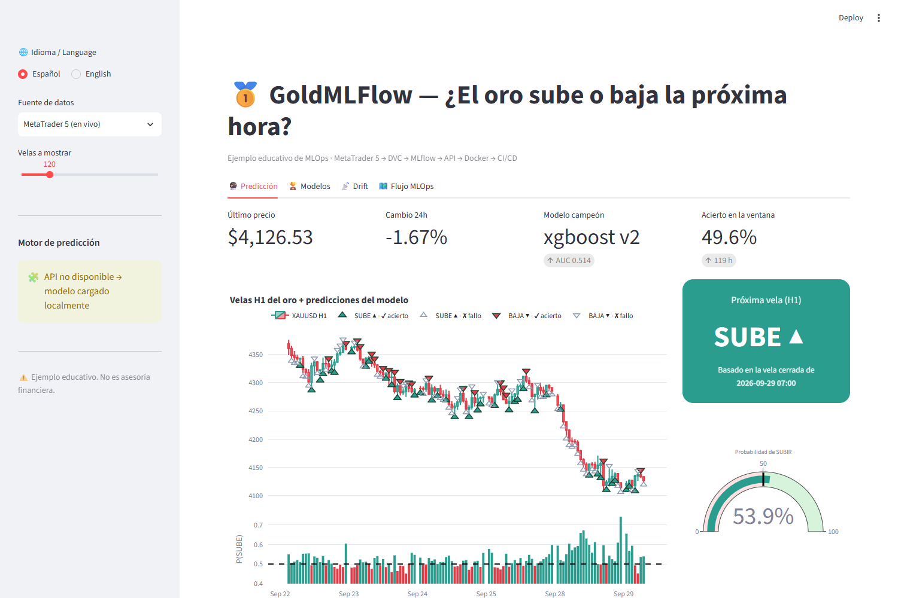
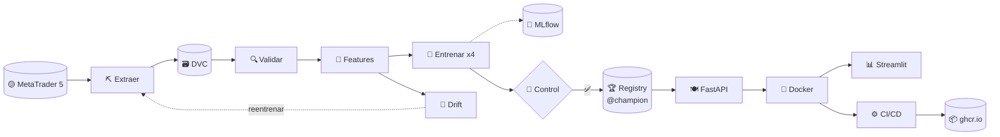
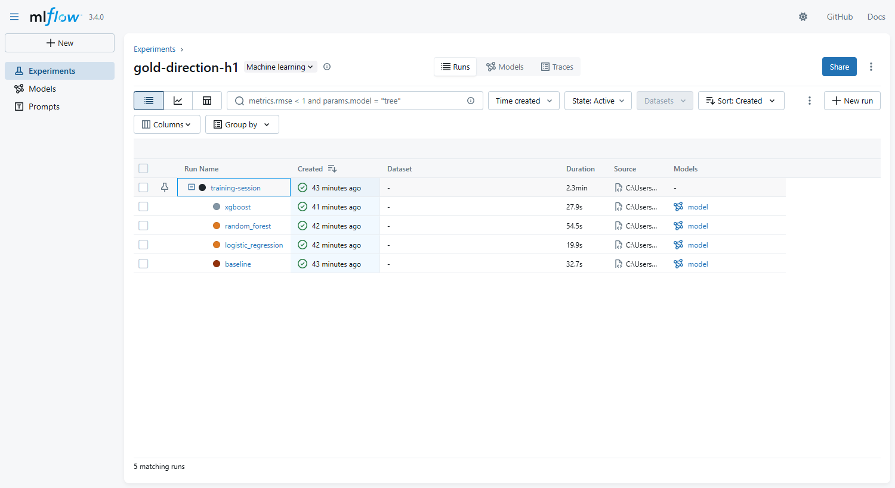
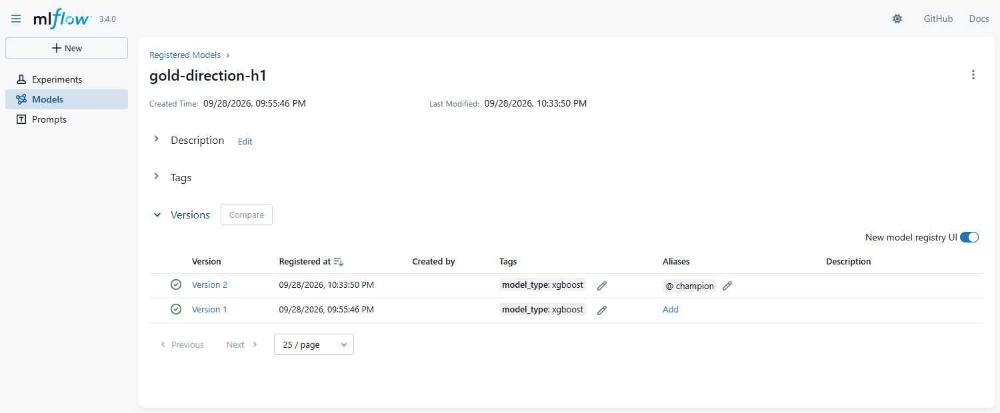
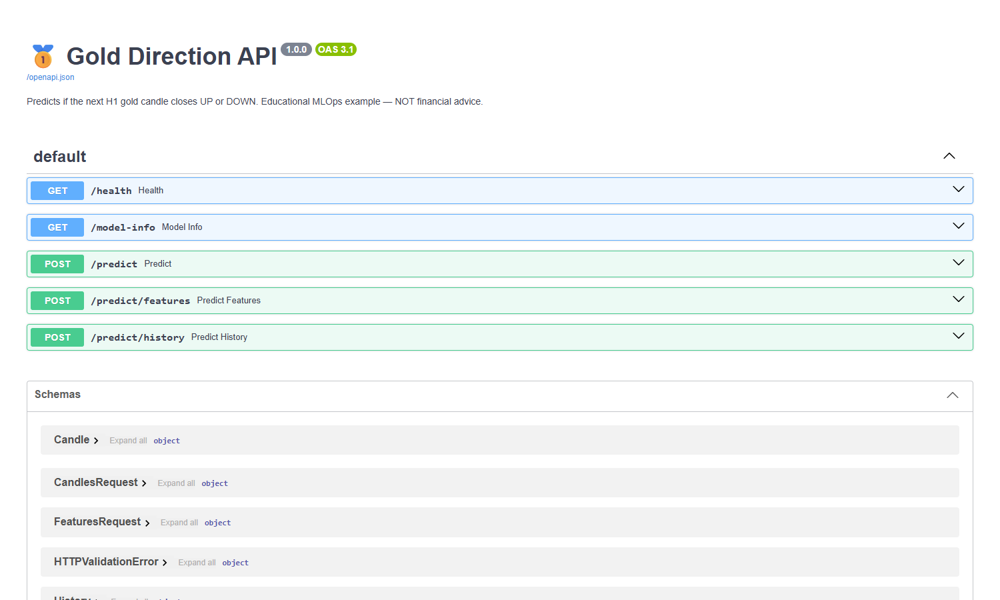
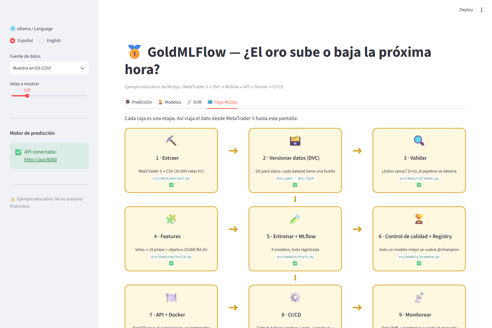

<div align="center">

# 🥇 GoldMLFlow

### MLOps para Dummies: predecir si el oro **SUBE ▲** o **BAJA ▼** en la próxima hora

**MetaTrader 5 → DVC → MLflow → FastAPI → Docker → GitHub Actions → Streamlit**

🌐 [English](README.md) · **Español** · 📗 [Guía PDF (ES)](docs/pdf/GoldMLFlow_Guia_ES.pdf) · 📕 [PDF guide (EN)](docs/pdf/GoldMLFlow_Guide_EN.pdf)

[](https://github.com/MirandaCR/GoldMLFlow/actions/workflows/ci.yml)
[](https://github.com/MirandaCR/GoldMLFlow/actions/workflows/cd.yml)




</div>

---

## 🤔 ¿Qué es esto?

Un **proyecto de MLOps completo, funcional y pensado para principiantes**, construido alrededor de una pregunta simple:

> **"¿La próxima vela de 1 hora del oro (XAUUSD) cerrará más arriba o más abajo?"**: una *clasificación binaria* sobre una *serie de tiempo*.

El modelo es simple a propósito. La estrella es **todo lo que lo rodea**: cómo se versionan los datos, cómo se registran los experimentos, cómo se aprueba un modelo, cómo se sirve, se empaqueta en contenedores, se prueba y se entrega de forma automática, y cómo nos damos cuenta cuando envejece.

Cada etapa tiene: 📓 un **notebook** para explorar → 🏭 un **script `.py` de producción** → ✅ **pruebas** → 📖 un **capítulo bilingüe** con diagramas y una analogía de restaurante.

## 🍳 MLOps explicado con un restaurante

| | Etapa | Herramienta | Analogía |
|---|---|---|---|
| ⛏️ | Extraer datos | MetaTrader 5 | 🛒 Comprar los ingredientes |
| 🗃️ | Versionar datos | **DVC** | 📸 Fotos con fecha de tu despensa |
| 🔍 | Validar | pandas | 🔍 Revisar que nada esté podrido |
| 🧩 | Features | pandas | 🔪 Picar los ingredientes |
| 🧪 | Entrenar y registrar | scikit-learn, XGBoost, **MLflow** | 👩‍🍳 Probar recetas + 📒 cuaderno de laboratorio |
| 🏆 | Control de calidad y registry | **MLflow Model Registry** | 🏅 El jurado elige el plato del menú |
| 🍽️ | Servir | **FastAPI** | 🧑‍🍳 El mesero |
| 🐳 | Contenedores | **Docker** | 🚚 Un food-truck que se estaciona en cualquier lugar |
| ⚙️ | CI/CD | **GitHub Actions** | 🕵️ El inspector de sanidad + entrega automática |
| 📡 | Monitorear | prueba KS de drift | 📋 ¿Los clientes siguen pidiendo lo mismo? |
| 📊 | Mostrar | **Streamlit** | 🪑 El comedor |

## 🗺️ El flujo completo



## 🚀 Inicio rápido

```powershell
git clone https://github.com/MirandaCR/GoldMLFlow.git; cd GoldMLFlow
python -m venv .venv; .\.venv\Scripts\Activate.ps1
pip install -r requirements-dev.txt

dvc repro                          # 🔁 ejecuta todo el pipeline (MetaTrader 5 debe estar abierto)
mlflow ui --backend-store-uri sqlite:///mlflow.db    # 🧪 experimentos → :5000
docker compose up --build          # 🐳 API :8000/docs  +  📊 dashboard :8501
python scripts/live_demo.py        # 🔮 predicción en vivo desde MT5
.\run_dashboard.ps1                # 📊 dashboard con el .venv (sin Docker)
```

¿Sin MetaTrader 5 (Mac/Linux)? Todo lo demás funciona con la muestra de `data/sample/` → ver [Instalación](docs/es/01-setup.md).

## 📚 Guía paso a paso

| # | Capítulo | Aprenderás |
|---|---|---|
| 00 | [🗺️ La foto completa](docs/es/00-big-picture.md) | Qué es MLOps y por qué existe |
| 01 | [🧰 Instalación y ejecutar todo](docs/es/01-setup.md) | Instalar y correr el proyecto |
| 02 | [⛏️ Extraer de MetaTrader 5](docs/es/02-extract-mt5.md) | Velas, símbolos, historia |
| 03 | [🗃️ Control de versiones de datos](docs/es/03-dvc.md) | `dvc repro`, `dvc.lock`, push/pull |
| 04 | [🔍🧩 Validar y features](docs/es/04-validate-features.md) | Pistas, objetivo y **fuga de datos** |
| 05 | [🧪 Entrenar + MLflow](docs/es/05-train-mlflow.md) | Validación walk-forward, tracking, sobreajuste |
| 06 | [🏆 Evaluar, control y registry](docs/es/06-evaluate-registry.md) | Métricas, control de calidad, `@champion` |
| 07 | [🍽️ API del modelo](docs/es/07-api.md) | FastAPI, Swagger, validación |
| 08 | [🐳 Docker](docs/es/08-docker.md) | Imágenes, contenedores, compose |
| 09 | [⚙️ CI/CD](docs/es/09-ci-cd.md) | GitHub Actions, ghcr.io |
| 10 | [📡 Monitoreo](docs/es/10-monitoring.md) | Data drift y reentrenamiento |
| 11 | [📊 Dashboard en Streamlit](docs/es/11-dashboard.md) | Ver y usar el modelo |
| 12 | [🔁 Notebook → producción](docs/es/12-notebook-to-production.md) | Cómo cada notebook se volvió un `.py` |
| 13 | [📖 Glosario y FAQ](docs/es/13-glossary-faq.md) | Cada término en palabras simples |

## 📊 Resultados reales (oro H1, test = últimos 12 meses, nunca vistos)

| Modelo | ROC-AUC | Acierto | |
|---|---|---|---|
| 🥇 **XGBoost** | **0,514** | **51,5 %** | ✅ pasó el control de calidad → `@champion` |
| Random Forest | 0,503 | 50,5 % | |
| Regresión logística | 0,503 | 50,5 % | |
| 🪙 Baseline (siempre SUBE) | 0,500 | 50,9 % | la moneda al aire a vencer |

> ⚠️ **Nota honesta:** ~51,5 % es normal en mercados horarios (son casi aleatorios). La estrategia de juguete ganó **+5,3 %** vs **+9,8 %** solo manteniendo oro. Este proyecto enseña **MLOps**, no trading. **No es asesoría financiera.**

<table>
<tr>
<td><br/><sub>🧪 MLflow: una ejecución por modelo</sub></td>
<td><br/><sub>🏆 Model Registry con el alias <code>@champion</code></sub></td>
</tr>
<tr>
<td><br/><sub>🍽️ Documentación interactiva de FastAPI</sub></td>
<td><br/><sub>📊 El flujo MLOps dentro del dashboard</sub></td>
</tr>
</table>

## 📂 Estructura del proyecto

```text
GoldMLFlow/
├── params.yaml                  🎛️ toda la configuración del pipeline
├── dvc.yaml · dvc.lock          🗃️ receta del pipeline + foto exacta
├── src/
│   ├── data/        extract.py · validate.py
│   ├── features/    build.py
│   ├── models/      train.py · promote.py · gate.py · check_gate.py · tracking.py
│   ├── api/         main.py · schemas.py
│   └── monitoring/  drift.py
├── app/dashboard.py             📊 Streamlit (ES/EN)
├── notebooks/                   📓 01…07 exploración  (+ exported/ como .py)
├── tests/                       ✅ datos · features (fuga) · API
├── scripts/                     🔮 live_demo.py · export_champion.py · build_pdf.py
├── models/champion/             🏆 campeón exportado (lo sirve la API)
├── reports/                     📈 metrics.json · drift.json · validación
├── docs/en · docs/es · docs/pdf 📖 guía bilingüe + PDFs
├── Dockerfile · Dockerfile.dashboard · docker-compose.yml   🐳
└── .github/workflows/ci.yml · cd.yml                          ⚙️
```

## 🧱 Tecnologías

`Python 3.12` · `pandas` · `scikit-learn` · `XGBoost` · `MLflow 3.4` · `DVC 3.63` · `FastAPI` · `Pydantic` · `Docker` · `GitHub Actions` · `Streamlit` · `Plotly` · `pytest` · `ruff` · `jupytext` · `MetaTrader5`

---
<div align="center"><sub>Proyecto educativo · No es asesoría financiera · Hecho para entender MLOps de punta a punta 🥇</sub></div>
