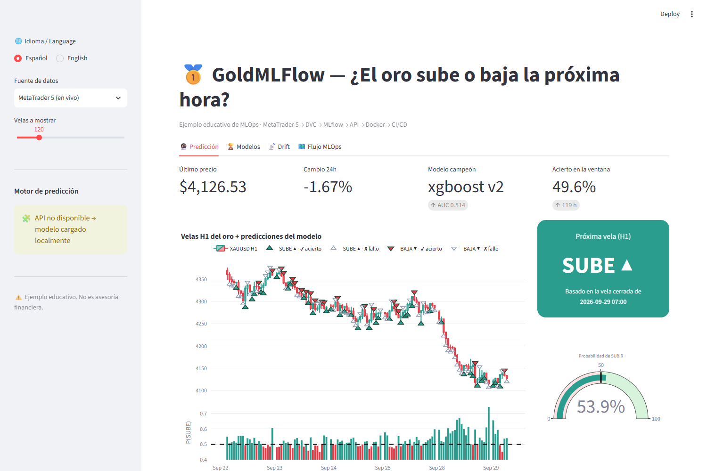
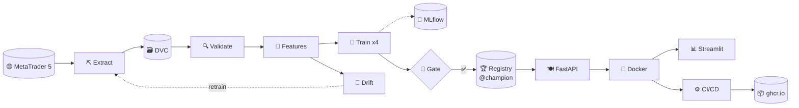
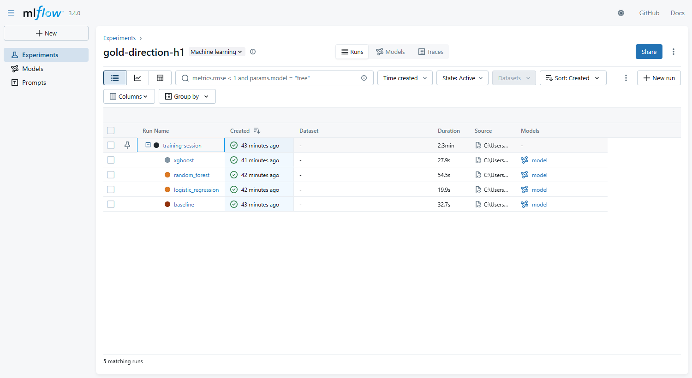
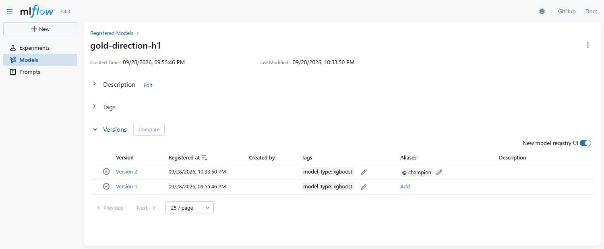
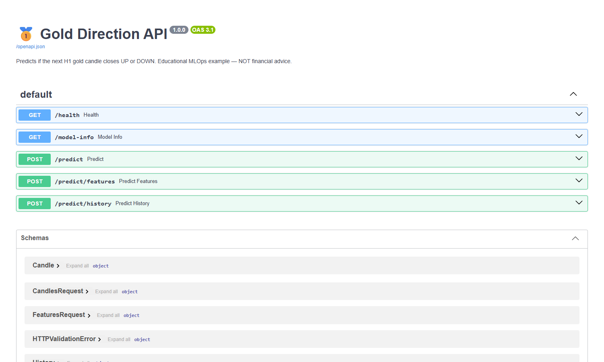
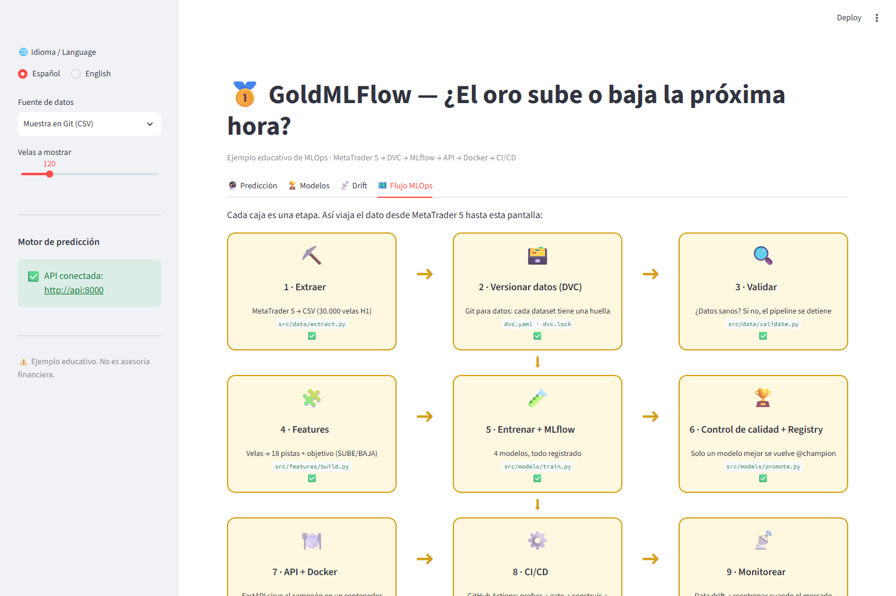

<div align="center">

# 🥇 GoldMLFlow

### MLOps for Dummies: predicting whether gold goes **UP ▲** or **DOWN ▼** in the next hour

**MetaTrader 5 → DVC → MLflow → FastAPI → Docker → GitHub Actions → Streamlit**

🌐 **English** · [Español](README.es.md) · 📕 [PDF guide (EN)](docs/pdf/GoldMLFlow_Guide_EN.pdf) · 📗 [Guía PDF (ES)](docs/pdf/GoldMLFlow_Guia_ES.pdf)

[](https://github.com/MirandaCR/GoldMLFlow/actions/workflows/ci.yml)
[](https://github.com/MirandaCR/GoldMLFlow/actions/workflows/cd.yml)




</div>

---

## 🤔 What is this?

A **complete, working, beginner-friendly MLOps project** built around one simple question:

> **"Will the next 1-hour candle of gold (XAUUSD) close higher or lower?"** — a *binary classification* on a *time series*.

The model is intentionally simple. The star of the show is **everything around it**: how data is versioned, how experiments are tracked, how a model is approved, served, containerized, tested and delivered automatically, and how we notice when it gets old.

Every stage has: 📓 a **notebook** to explore → 🏭 a **production `.py`** script → ✅ **tests** → 📖 a **bilingual chapter** with diagrams and a restaurant analogy.

## 🍳 MLOps explained with a restaurant

| | Stage | Tool | Analogy |
|---|---|---|---|
| ⛏️ | Extract data | MetaTrader 5 | 🛒 Buying the ingredients |
| 🗃️ | Version data | **DVC** | 📸 Dated photos of your pantry |
| 🔍 | Validate | pandas | 🔍 Checking nothing is rotten |
| 🧩 | Features | pandas | 🔪 Chopping the ingredients |
| 🧪 | Train & track | scikit-learn, XGBoost, **MLflow** | 👩‍🍳 Trying recipes + 📒 lab notebook |
| 🏆 | Quality gate & registry | **MLflow Model Registry** | 🏅 The jury picks the menu dish |
| 🍽️ | Serve | **FastAPI** | 🧑‍🍳 The waiter |
| 🐳 | Containerize | **Docker** | 🚚 A food-truck that parks anywhere |
| ⚙️ | CI/CD | **GitHub Actions** | 🕵️ The health inspector + automatic delivery |
| 📡 | Monitor | KS drift test | 📋 Are customers still ordering the same? |
| 📊 | Show | **Streamlit** | 🪑 The dining room |

## 🗺️ The whole flow



## 🚀 Quick start

```powershell
git clone https://github.com/MirandaCR/GoldMLFlow.git; cd GoldMLFlow
python -m venv .venv; .\.venv\Scripts\Activate.ps1
pip install -r requirements-dev.txt

dvc repro                          # 🔁 run the whole pipeline (MetaTrader 5 must be open)
mlflow ui --backend-store-uri sqlite:///mlflow.db    # 🧪 experiments  → :5000
docker compose up --build          # 🐳 API :8000/docs  +  📊 dashboard :8501
python scripts/live_demo.py        # 🔮 live prediction from MT5
```

No MetaTrader 5 (Mac/Linux)? Everything else works with the sample in `data/sample/` → see [Setup](docs/en/01-setup.md).

## 📚 Step-by-step guide

| # | Chapter | You'll learn |
|---|---|---|
| 00 | [🗺️ The big picture](docs/en/00-big-picture.md) | What MLOps is and why it exists |
| 01 | [🧰 Setup & run everything](docs/en/01-setup.md) | Install and run the project |
| 02 | [⛏️ Extract from MetaTrader 5](docs/en/02-extract-mt5.md) | Candles, symbols, history |
| 03 | [🗃️ Data Version Control](docs/en/03-dvc.md) | `dvc repro`, `dvc.lock`, push/pull |
| 04 | [🔍🧩 Validate & features](docs/en/04-validate-features.md) | Clues, target and **data leakage** |
| 05 | [🧪 Train + MLflow](docs/en/05-train-mlflow.md) | Walk-forward CV, tracking, overfitting |
| 06 | [🏆 Evaluate, gate & registry](docs/en/06-evaluate-registry.md) | Metrics, quality gate, `@champion` |
| 07 | [🍽️ Model API](docs/en/07-api.md) | FastAPI, Swagger, validation |
| 08 | [🐳 Docker](docs/en/08-docker.md) | Images, containers, compose |
| 09 | [⚙️ CI/CD](docs/en/09-ci-cd.md) | GitHub Actions, ghcr.io |
| 10 | [📡 Monitoring](docs/en/10-monitoring.md) | Data drift and retraining |
| 11 | [📊 Streamlit dashboard](docs/en/11-dashboard.md) | See and use the model |
| 12 | [🔁 Notebook → production](docs/en/12-notebook-to-production.md) | How each notebook became a `.py` |
| 13 | [📖 Glossary & FAQ](docs/en/13-glossary-faq.md) | Every term in plain words |

## 📊 Real results (gold H1, test = last 12 months, never seen)

| Model | ROC-AUC | Accuracy | |
|---|---|---|---|
| 🥇 **XGBoost** | **0.514** | **51.5%** | ✅ passed the quality gate → `@champion` |
| Random Forest | 0.503 | 50.5% | |
| Logistic Regression | 0.503 | 50.5% | |
| 🪙 Baseline (always UP) | 0.500 | 50.9% | the coin flip to beat |

> ⚠️ **Honest note:** ~51.5% is normal for hourly markets (they're almost random). The toy strategy made **+5.3%** vs **+9.8%** just holding gold. This project teaches **MLOps**, not trading. **Not financial advice.**

<table>
<tr>
<td><br/><sub>🧪 MLflow: one run per model</sub></td>
<td><br/><sub>🏆 Model Registry with the <code>@champion</code> alias</sub></td>
</tr>
<tr>
<td><br/><sub>🍽️ FastAPI interactive docs</sub></td>
<td><br/><sub>📊 The MLOps flow inside the dashboard</sub></td>
</tr>
</table>

## 📂 Project structure

```text
GoldMLFlow/
├── params.yaml                  🎛️ every setting of the pipeline
├── dvc.yaml · dvc.lock          🗃️ pipeline recipe + exact snapshot
├── src/
│   ├── data/        extract.py · validate.py
│   ├── features/    build.py
│   ├── models/      train.py · promote.py · gate.py · check_gate.py · tracking.py
│   ├── api/         main.py · schemas.py
│   └── monitoring/  drift.py
├── app/dashboard.py             📊 Streamlit (ES/EN)
├── notebooks/                   📓 01…07 exploration  (+ exported/ as .py)
├── tests/                       ✅ data · features (leakage) · API
├── scripts/                     🔮 live_demo.py · export_champion.py · build_pdf.py
├── models/champion/             🏆 exported champion (served by the API)
├── reports/                     📈 metrics.json · drift.json · validation
├── docs/en · docs/es · docs/pdf 📖 bilingual guide + PDFs
├── Dockerfile · Dockerfile.dashboard · docker-compose.yml   🐳
└── .github/workflows/ci.yml · cd.yml                          ⚙️
```

## 🧱 Tech stack

`Python 3.12` · `pandas` · `scikit-learn` · `XGBoost` · `MLflow 3.4` · `DVC 3.63` · `FastAPI` · `Pydantic` · `Docker` · `GitHub Actions` · `Streamlit` · `Plotly` · `pytest` · `ruff` · `jupytext` · `MetaTrader5`

---
<div align="center"><sub>Educational project · Not financial advice · Made to understand MLOps end to end 🥇</sub></div>
