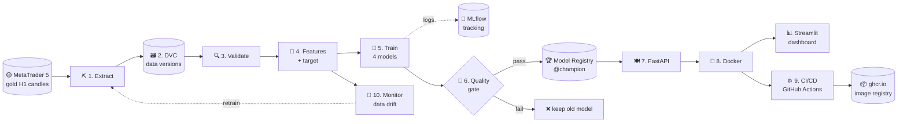

# 00 · The Big Picture — What is MLOps?

> 🌐 **English** · [Español](../es/00-big-picture.md) · [🏠 README](../../README.md) · Next ➡️ [01 · Setup](01-setup.md)

## 🤔 The problem MLOps solves

Training a model in a notebook is like **cooking one great dish at home**.
MLOps is **running a restaurant** that serves that dish every day, with the same taste, safely and on time, and changes the recipe when customers' tastes change.

| At home (just a notebook) 🏠 | Restaurant (MLOps) 🍽️ |
|---|---|
| "Where did I get that data?" | Data is **versioned** (DVC): you can go back to any version |
| "Which settings gave 0.51?" | Every experiment is **logged** (MLflow) |
| "It works on my laptop" | It's **packed in a container** (Docker) and runs anywhere |
| "I copied the model by email" | The model is served through an **API** |
| "I hope I didn't break anything" | **Automatic tests** on every change (CI) |
| "I deploy by hand on Fridays" | **Automatic delivery** when tests pass (CD) |
| "The model got worse… when?" | **Monitoring** warns when the market changes (drift) |

## 🥇 Our example in one sentence

> **Every hour, predict whether the next H1 candle of gold (XAUUSD) will close UP (1) or DOWN (0)**, using data from MetaTrader 5, and run everything around it the MLOps way.

It's a **binary classification** problem on a **time series**.

## 🗺️ The full flow



## 🍳 The restaurant analogy (keep it in mind for every chapter)

| Stage | Tool | Restaurant analogy |
|---|---|---|
| Extract | MetaTrader 5 + Python | 🛒 Buying the ingredients at the market |
| Version data | **DVC** | 📸 Dated photos of your pantry: you can always go back |
| Validate | pandas checks | 🔍 Checking the ingredients aren't rotten |
| Features | pandas | 🔪 Chopping and preparing the ingredients |
| Train | scikit-learn, XGBoost | 👩‍🍳 Trying several recipes |
| Track | **MLflow** | 📒 A lab notebook where every attempt is written down |
| Gate + registry | **MLflow Model Registry** | 🏅 The jury picks the dish that goes on the menu |
| API | **FastAPI** | 🧑‍🍳 The waiter who takes orders and brings the dish |
| Container | **Docker** | 🚚 A food-truck: the whole kitchen, ready to park anywhere |
| CI/CD | **GitHub Actions** | 🕵️ The health inspector checks every change before opening |
| Dashboard | **Streamlit** | 🪑 The dining room where customers see and enjoy the food |
| Monitor | KS drift test | 📋 Checking whether customers still order the same things |

## 📂 Where is each piece?

```text
GoldMLFlow/
├── params.yaml              ← 🎛️ control panel: every setting lives here
├── dvc.yaml / dvc.lock      ← 🗃️ pipeline recipe + exact snapshot of every stage
├── src/
│   ├── data/extract.py      ← ⛏️ stage 1
│   ├── data/validate.py     ← 🔍 stage 3
│   ├── features/build.py    ← 🧩 stage 4
│   ├── models/train.py      ← 🧪 stage 5
│   ├── models/promote.py    ← 🚦🏆 stage 6
│   ├── api/main.py          ← 🍽️ stage 7
│   └── monitoring/drift.py  ← 📡 stage 10
├── app/dashboard.py         ← 📊 Streamlit app
├── notebooks/               ← 📓 exploration (one per stage) → became src/*.py
├── tests/                   ← ✅ automatic tests (run by CI)
├── Dockerfile(.dashboard), docker-compose.yml  ← 🐳
└── .github/workflows/       ← ⚙️ CI (ci.yml) and CD (cd.yml)
```

## ⚠️ Honest expectations

Hourly gold moves are **almost random**. Our best model is right **~51.5%** of the time (the "always UP" baseline gets ~50.9%).
That is normal and is **not** the point: this project teaches the **process**. If a trading model ever shows 90% accuracy, suspect a bug (see [data leakage](04-validate-features.md#-data-leakage-the-1-trap)).

> 📌 Educational project. **Not financial advice.**

---
➡️ Next: [01 · Setup & run everything](01-setup.md)
