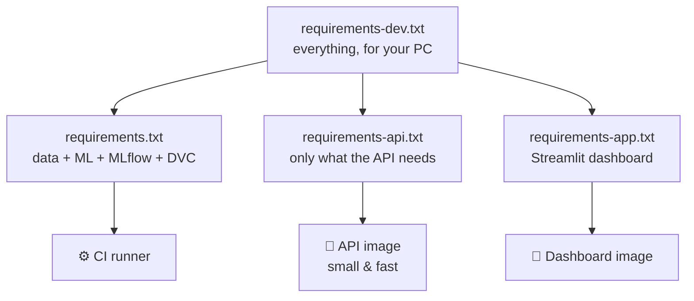

# 01 · Setup & run everything

> 🌐 **English** · [Español](../es/01-setup.md) · ⬅️ [00 · Big picture](00-big-picture.md) · ➡️ [02 · Extract](02-extract-mt5.md)

| | |
|---|---|
| 🍳 **Analogy** | Preparing the kitchen before cooking |
| 🎯 **Goal** | Have Python, the libraries, MT5, Docker and Git ready |
| ⏱️ **Time** | ~15 minutes |

## ✅ Requirements

| Tool | Why | Check |
|---|---|---|
| **Windows 10/11** | The `MetaTrader5` Python package only exists for Windows | — |
| **MetaTrader 5 terminal** (open & logged in, demo account is fine) | Source of gold prices | open the app |
| **Python 3.11 or 3.12** | Runs everything | `python --version` |
| **Git** | Versions the code | `git --version` |
| **Docker Desktop** | Containers | `docker --version` |
| GitHub account | CI/CD | — |

## 🧰 Step by step

```powershell
# 1) Get the code
git clone https://github.com/MirandaCR/GoldMLFlow.git
cd GoldMLFlow

# 2) Create an isolated Python environment ("a clean kitchen just for this recipe")
python -m venv .venv
.\.venv\Scripts\Activate.ps1

# 3) Install everything (core + API + dashboard + notebooks + tests)
pip install -r requirements-dev.txt
```

### 📦 Why 4 requirements files?



Each container installs **only what it needs** → smaller, faster and safer images.

## 🚀 Run the whole pipeline (one command)

With MetaTrader 5 **open**:

```powershell
dvc repro          # extract → validate → features → train → promote → drift
```

You'll see each stage run in order. Run it again and DVC says *"didn't change, skipping"*: it only re-runs what changed.

> ⚠️ **Always activate the `.venv` first** (the prompt shows `(.venv)`). Running with the global Python gives `ModuleNotFoundError: No module named 'mlflow'`. Shortcut for the dashboard: `.\run_dashboard.ps1`.

## 👀 Look at the results

```powershell
mlflow ui --backend-store-uri sqlite:///mlflow.db     # 🧪 experiments  → http://localhost:5000
uvicorn src.api.main:app                               # 🍽️ API          → http://localhost:8000/docs
streamlit run app/dashboard.py                         # 📊 dashboard    → http://localhost:8501
docker compose up --build                              # 🐳 API + dashboard in containers
python scripts/live_demo.py                            # 🔮 live MT5 prediction in the terminal
jupyter lab notebooks/                                 # 📓 the exploration notebooks
pytest                                                 # ✅ tests
```

> 💡 **Port 8000 busy?** (another app is using it) → `$env:API_PORT=8010; docker compose up` and use `http://localhost:8010`.

## 🧪 No MetaTrader 5? (Mac/Linux or no account)

Everything except extraction still works with the **sample** stored in Git (`data/sample/xauusd_h1_sample.csv`, last 4,000 candles):

```powershell
python -m src.data.validate  --input data/sample/xauusd_h1_sample.csv
python -m src.features.build --input data/sample/xauusd_h1_sample.csv --output data/processed/features.csv
python -m src.models.train
python -m src.models.promote
```

That's exactly what the CI robot does on GitHub (Linux, no MT5).

---
⬅️ [00 · Big picture](00-big-picture.md) · ➡️ [02 · Extract from MetaTrader 5](02-extract-mt5.md)
