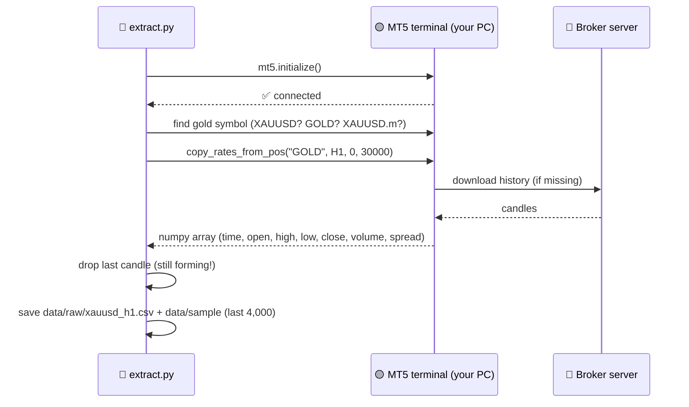
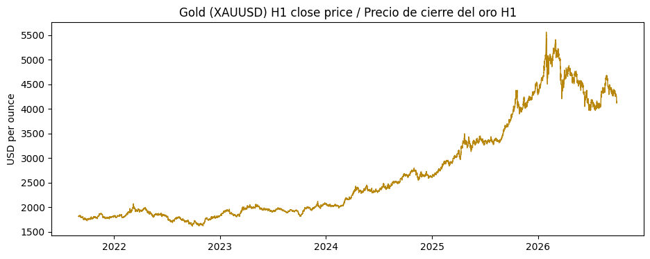

# 02 · Extract gold data from MetaTrader 5

> 🌐 **English** · [Español](../es/02-extract-mt5.md) · ⬅️ [01 · Setup](01-setup.md) · ➡️ [03 · DVC](03-dvc.md)

| | |
|---|---|
| 🍳 **Analogy** | 🛒 Going to the market to buy the ingredients |
| 🎯 **Goal** | Download hourly (H1) gold candles into a CSV |
| 📓 **Notebook** | [`notebooks/01_extract_mt5.ipynb`](../../notebooks/01_extract_mt5.ipynb) |
| 🏭 **Production code** | [`src/data/extract.py`](../../src/data/extract.py) |
| ▶️ **Run** | `dvc repro extract` (or `python -m src.data.extract --sample`) |

## 🔌 How it works



## 🕯️ What is a candle?

```text
      high ─┬─          Each row = 1 hour of trading
            │
     ┌──────┴──┐ close   green: close > open → price went UP ▲
     │  body   │         red:   close < open → price went DOWN ▼
     └──────┬──┘ open
            │
      low  ─┴─
```

| time | open | high | low | close | volume |
|---|---|---|---|---|---|
| 2021-08-31 18:00 | 1807.03 | 1808.94 | 1804.15 | 1807.78 | 9978 |
| 2021-08-31 19:00 | 1807.86 | 1814.04 | 1807.42 | 1813.83 | 5287 |

## 📊 How much history is there?

Our broker calls gold **`GOLD`** and has **82,525 H1 candles (June 2001 → today)**.
We use the **last 30,000 (~5 years: Aug 2021 → Sep 2026)**.



**Why not all 25 years?** Markets change: gold in 2005 had different volatility, liquidity and trading hours. Five years give ~30k examples and stay relevant. It's a setting (`params.yaml → data.n_bars`), so you can try more.

## 🧠 Key details that matter in production

| Detail | Why |
|---|---|
| **Symbol auto-detection** (`symbol_candidates`) | Every broker names gold differently |
| **Drop the last candle** | It's still forming; its "close" will change → it would be a lie |
| **Broker server time** | MT5 timestamps are in the broker's time zone (usually GMT+2/+3) |
| **Import MT5 inside the function** | So the rest of the project works on Linux (CI/Docker) where MT5 doesn't exist |
| **Sample file** (`--sample`) | A small copy (4,000 candles) stored in Git for CI tests |

## 🧪 Try it yourself

1. In `params.yaml`, change `n_bars: 30000` to `50000` and run `dvc repro`. What does DVC re-run? (Hint: *everything*, because the raw data changed.)
2. Change `timeframe: H1` to `H4`. How many candles do you get? How does accuracy change?

---
⬅️ [01 · Setup](01-setup.md) · ➡️ [03 · Data Version Control (DVC)](03-dvc.md)
