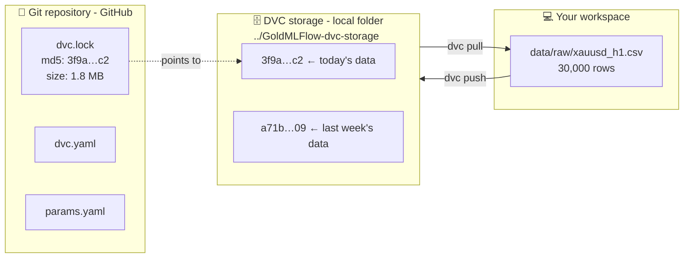
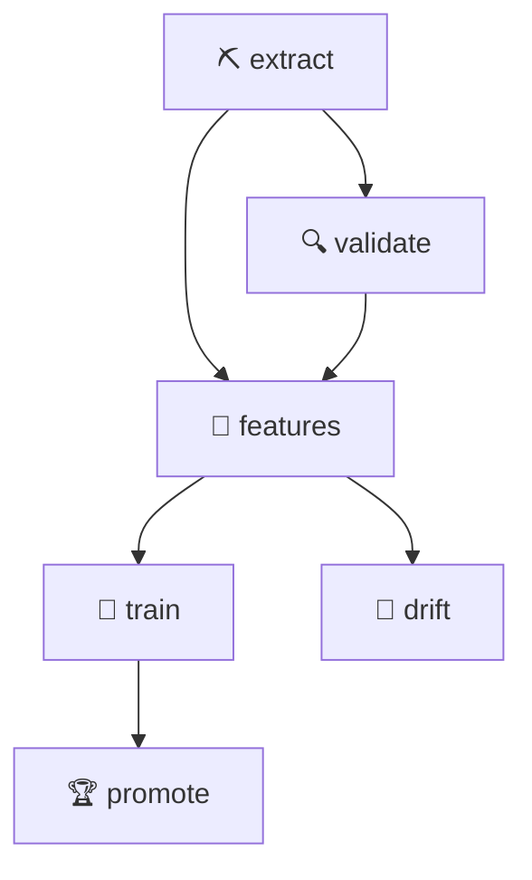

# 03 · Data Version Control (DVC)

> 🌐 **English** · [Español](../es/03-dvc.md) · ⬅️ [02 · Extract](02-extract-mt5.md) · ➡️ [04 · Validate & features](04-validate-features.md)

| | |
|---|---|
| 🍳 **Analogy** | 📸 Dated photos of your pantry: you can always go back to yesterday's |
| 🎯 **Goal** | Version big data files + make the pipeline reproducible |
| 🏭 **Files** | [`dvc.yaml`](../../dvc.yaml), `dvc.lock`, `.dvc/config`, [`params.yaml`](../../params.yaml) |
| ▶️ **Run** | `dvc repro`, `dvc push`, `dvc pull`, `dvc dag`, `dvc metrics show` |

## 🤔 Why not just put the CSV in Git?

Git is great for **code** (small text files), bad for **data** (big files that change entirely).
DVC = **"Git for data"**: Git stores a tiny *fingerprint* (hash) of the file; the file itself lives in a **storage** (here, a local folder).



## 🏗️ Our pipeline (`dvc.yaml`)

Each **stage** declares: the command, what it **depends on** (code, data, params) and what it **produces**.



(This is what `dvc dag` prints.)

```yaml
  train:
    cmd: python -m src.models.train
    deps:                           # if any of these change → re-run
      - src/models/train.py
      - data/processed/features.csv
    params:
      - train                       # only the "train:" section of params.yaml
    outs:
      - reports/train_results.json
```

### 🧠 The magic: `dvc repro` only re-runs what changed

| You change… | DVC re-runs… |
|---|---|
| `train.models.xgboost.max_depth` in params.yaml | train → promote |
| `features.rsi_window` | features → train → promote → drift |
| `src/monitoring/drift.py` | only drift |
| nothing | nothing (*"didn't change, skipping"*) |

## 📸 `dvc.lock` = the exact snapshot

After each run, `dvc.lock` records the **md5 of every input and output**. Commit it with Git → anyone can reproduce **exactly** the same result months later:

```powershell
git checkout <old-commit>   # code + dvc.lock of that day
dvc pull                    # the data of that day
dvc repro                   # same results
```

## 🗄️ Our local storage

```powershell
dvc remote add -d localstorage ../GoldMLFlow-dvc-storage   # already configured in .dvc/config
dvc push      # upload data versions to the storage
dvc pull      # download the data that matches the current dvc.lock
```

> 🏢 In a company, the storage would be S3, Google Cloud Storage, Azure Blob or a shared drive: just change the remote URL. Everything else stays the same.

## 🔀 What goes to Git vs DVC?

| File | Where | Why |
|---|---|---|
| `data/raw/xauusd_h1.csv` (1.8 MB, changes) | **DVC** | big data |
| `data/processed/features.csv` | **DVC** | generated data |
| `data/sample/xauusd_h1_sample.csv` (small) | **Git** (`cache: false`) | CI needs it and can't reach the local storage |
| `models/champion/` (371 KB) | **Git** (`cache: false`) | the Docker image is built from it in CD |
| `reports/metrics.json` | **Git** (`metrics:`) | compare runs with `dvc metrics diff` |

## 🧪 Try it yourself

```powershell
dvc dag                       # draw the pipeline
dvc metrics show              # current metrics
# change train.models.xgboost.max_depth to 5 in params.yaml, then:
dvc repro
dvc metrics diff              # compare with the last commit
dvc params diff               # which params changed
```

---
⬅️ [02 · Extract](02-extract-mt5.md) · ➡️ [04 · Validate & features](04-validate-features.md)
