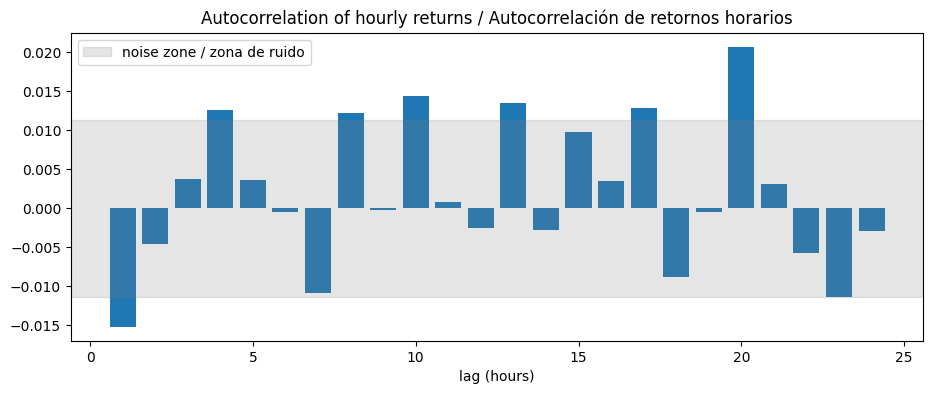
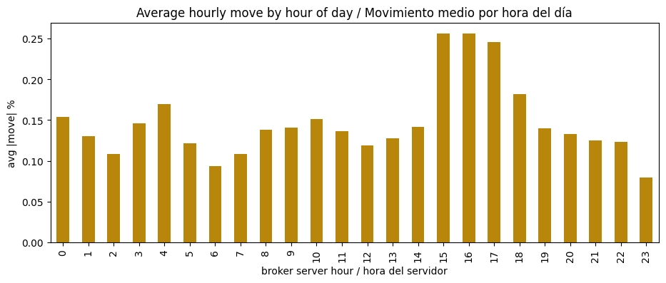
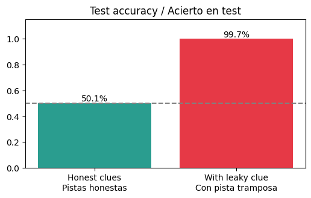

# 04 · Validate data & build features

> 🌐 **English** · [Español](../es/04-validate-features.md) · ⬅️ [03 · DVC](03-dvc.md) · ➡️ [05 · Train + MLflow](05-train-mlflow.md)

| | |
|---|---|
| 🍳 **Analogy** | 🔍 Checking the ingredients aren't rotten, then 🔪 chopping them |
| 🎯 **Goal** | Guarantee healthy data, then turn candles into numeric "clues" + the answer |
| 📓 **Notebooks** | [`02_validate_explore`](../../notebooks/02_validate_explore.ipynb), [`03_features`](../../notebooks/03_features.ipynb) |
| 🏭 **Production code** | [`src/data/validate.py`](../../src/data/validate.py), [`src/features/build.py`](../../src/features/build.py) |
| ✅ **Tests** | [`tests/test_data.py`](../../tests/test_data.py), [`tests/test_features.py`](../../tests/test_features.py) |

## Part A · 🔍 Validation — "garbage in, garbage out"

Before any model sees the data, 8 yes/no questions:

| Check | Catches… |
|---|---|
| required_columns | a broken export |
| enough_rows (≥ 1,000) | MT5 returned almost nothing |
| no_missing_values | empty cells |
| no_duplicated_timestamps | the same hour twice |
| time_is_sorted | shuffled rows |
| prices_positive | zeros / negative prices |
| high_is_highest / low_is_lowest | impossible candles |

If **any** check fails → the script exits with code 1 → **DVC stops the pipeline**. No model is trained on broken data.

```text
✅ required_columns   ✅ enough_rows   ✅ no_missing_values   ✅ no_duplicated_timestamps
✅ time_is_sorted     ✅ prices_positive   ✅ high_is_highest   ✅ low_is_lowest
Data validation passed (29999 rows)
```

### 🔎 What exploring the data taught us

| Finding | Chart | Consequence |
|---|---|---|
| UP 50.9% / DOWN 49.1% | — | "Always UP" is already right 50.9% → that's the **baseline to beat** |
| Hourly returns barely correlate with the past |  | Expect ~51–53%, not 90% |
| Gold moves most at London / New York opens |  | Give the model the **hour of day** |

## Part B · 🧩 Features — turning candles into clues

A model can't read a chart. For each candle *t* we compute numbers that describe **only the past**, plus the **target**:

```text
 candle t-200 … t-1, t   ──▶   clues(t)   ──▶  🤖  ──▶  will candle t+1 close higher?
       (only the PAST)                                  target = 1 (UP) / 0 (DOWN)
```

| Family | Clues | Plain words |
|---|---|---|
| 🏃 Momentum | `ret_1h, ret_2h, ret_3h, ret_5h, ret_10h, ret_24h` | How much did price move in the last N hours? |
| 📈 Trend | `dist_sma_10, dist_sma_50, dist_sma_200` | Is price above or below its average? |
| 🎚️ Oscillators | `rsi`, `macd_hist` | Is it "tired" of going up/down? |
| 🌪️ Risk | `volatility`, `range_pct`, `body_pct` | How nervous is the market? |
| 📊 Activity | `volume_z` | Is there unusual activity? |
| 🕐 Calendar | `hour_sin, hour_cos, dayofweek` | Asia? London? New York? Friday? |

**Result:** 29,799 rows × 18 clues + target.

> 🕐 **Why sin/cos for the hour?** To a model, 23:00 and 00:00 look far apart (23 vs 0), but they're neighbours. Placing hours on a circle fixes it.

## 🚨 Data leakage: the #1 trap

**Leakage = a clue that accidentally contains information from the future.** On paper the model looks like a genius; in real life it loses money, because in real time the future doesn't exist yet.

In notebook 03 we add one innocent-looking clue: a moving average **centered** on the candle (it averages the previous hour, the current hour… **and the next hour**):



**50.1% → 99.7%** with a single line of code. **If results look too good to be true, they are.**

### 🛡️ How production protects us

```python
def test_no_leakage_features_ignore_the_future(sample_raw, params):
    """Changing FUTURE prices must not change today's clues."""
    base = make_features(sample_raw, ...)
    tampered = sample_raw.copy()
    tampered.loc[last 100 rows, prices] *= 1.5       # 🔨 change the future
    after = make_features(tampered, ...)
    assert clues of the older rows are identical      # ✅ or CI fails
```

This test runs on **every push** in GitHub Actions.

## ♻️ Same code for training and serving

```python
make_features(df, params, with_target=True)   # training: adds target, drops last candle (no future yet)
make_features(df, params, with_target=False)  # API: same clues, keeps the last candle to predict it
```

Using **one function** in both places avoids *training/serving skew* (the API computing clues slightly differently from training → silent errors).

---
⬅️ [03 · DVC](03-dvc.md) · ➡️ [05 · Train models + MLflow](05-train-mlflow.md)
