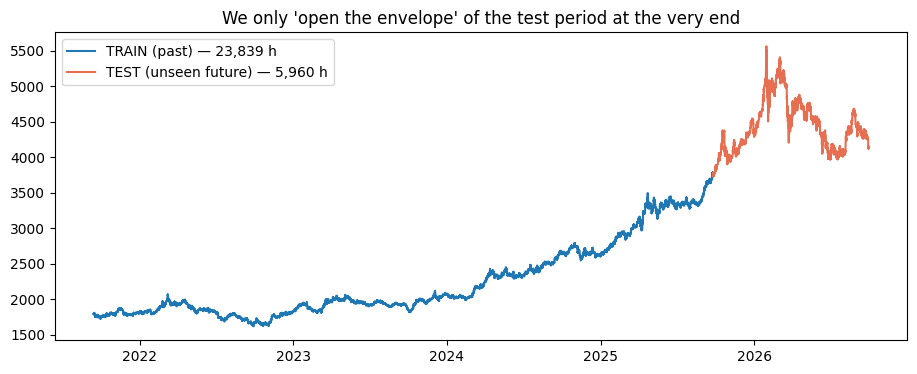
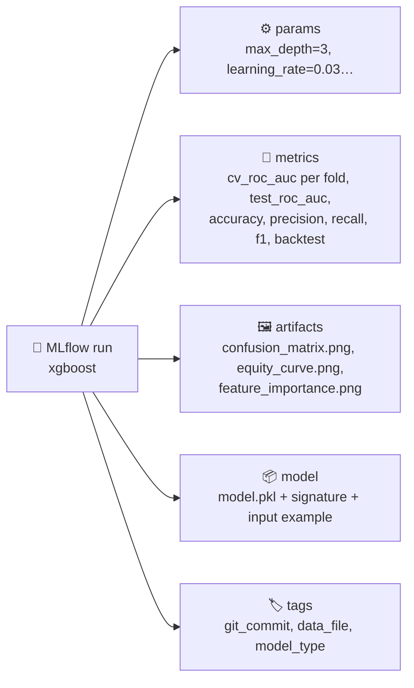
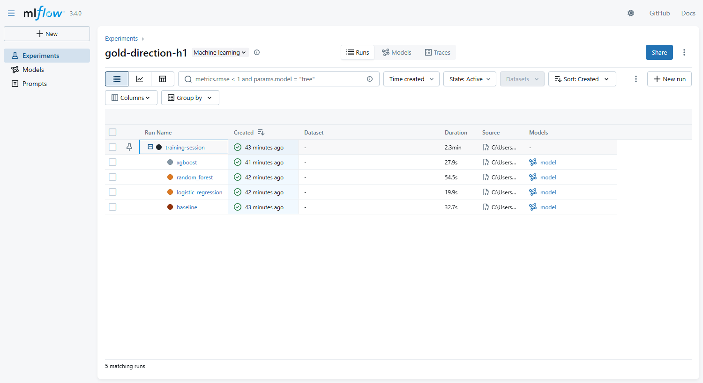
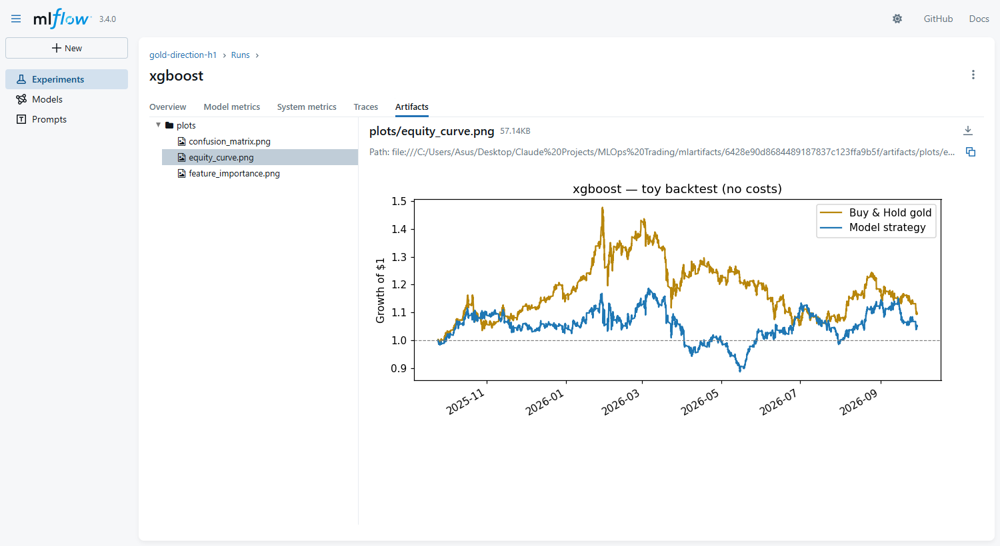
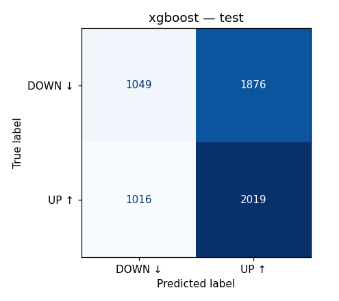
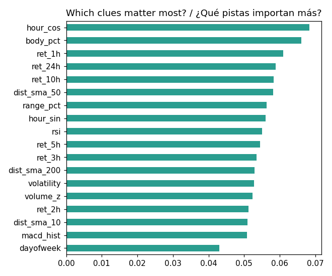
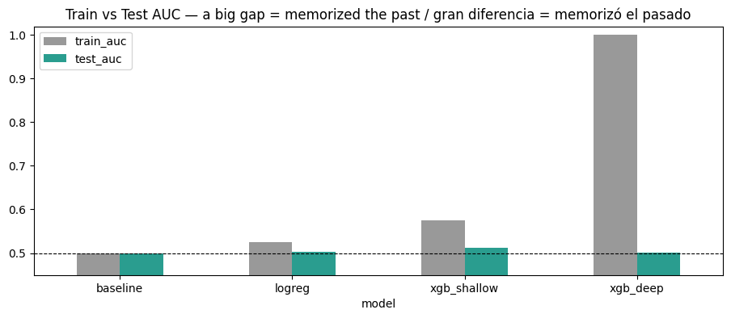

# 05 · Train models & track them with MLflow

> 🌐 **English** · [Español](../es/05-train-mlflow.md) · ⬅️ [04 · Features](04-validate-features.md) · ➡️ [06 · Evaluate & registry](06-evaluate-registry.md)

| | |
|---|---|
| 🍳 **Analogy** | 👩‍🍳 Trying several recipes and 📒 writing everything down in a lab notebook |
| 🎯 **Goal** | Compare models fairly and never lose a result |
| 📓 **Notebook** | [`04_train_mlflow`](../../notebooks/04_train_mlflow.ipynb) |
| 🏭 **Production code** | [`src/models/train.py`](../../src/models/train.py), [`src/models/tracking.py`](../../src/models/tracking.py) |
| ▶️ **Run** | `dvc repro train` · UI: `mlflow ui --backend-store-uri sqlite:///mlflow.db` |

## ⏳ Rule #1 for time series: never shuffle

```text
|■■■■■■■■■■■■■■■■■■■■■■■ TRAIN 80% (past) ■■■■■■■■■■■■■■■■■■■■■■■|□□□ TEST 20% (unseen future) □□□|
 2021-09-13 ────────────────────────────────────────────── 2025-09-24 ──────────────────── 2026-09-29
             23,839 hours                                                5,960 hours
```



Inside the training part we use **walk-forward cross-validation** (`TimeSeriesSplit`): "practice exams", always training on the past and testing on what comes next.

```text
fold 1: ▓▓▓░
fold 2: ▓▓▓▓▓░
fold 3: ▓▓▓▓▓▓▓░          ▓ = train   ░ = validate
fold 4: ▓▓▓▓▓▓▓▓▓░
fold 5: ▓▓▓▓▓▓▓▓▓▓▓░
```

## 🤖 The 4 contestants

| Model | Idea | Why it's here |
|---|---|---|
| **baseline** (`DummyClassifier`) | always says the most common answer (UP) | 🪙 the "coin flip" every model must beat |
| **logistic_regression** | a weighted sum of the clues | simple, fast, hard to overfit |
| **random_forest** | 300 decision trees vote | captures non-linear patterns |
| **xgboost** | trees that fix each other's mistakes | usually the strongest on tabular data |

Every model is an sklearn **`Pipeline`** (e.g. scaler + model) so preprocessing **travels with the model** to the API.

## 📒 What MLflow records for every model



Runs are **nested**: one parent `training-session` with one child per model.



### 🖼️ Charts saved inside each run



| Confusion matrix | Feature importance |
|---|---|
|  |  |

### ✍️ The "signature": the model's contract

MLflow stores which columns (and types) go in and what comes out. If someone later sends the wrong columns, MLflow warns instead of silently predicting garbage.

## 📊 Results (test = the last 12 months, never seen)

| Model | test ROC-AUC | test accuracy |
|---|---|---|
| 🥇 **xgboost** | **0.5140** | **51.48%** |
| random_forest | 0.5032 | 50.45% |
| logistic_regression | 0.5028 | 50.45% |
| baseline 🪙 | 0.5000 | 50.92% |

## 🎓 Lesson from the notebook: overfitting



`xgb_deep` (8 levels deep) scores **0.999 AUC on the past** but **0.501 on the future**: it **memorized noise**. On noisy markets, simpler models generalize better.

## 🗂️ Where is the data stored?

| Mode | How | Use |
|---|---|---|
| **Local (default)** | `mlflow.db` (SQLite) + `mlartifacts/` folder | learning, one person |
| **Team** | `docker compose --profile team up mlflow` + `$env:MLFLOW_TRACKING_URI="http://localhost:5000"` | a shared server for everyone |

---
⬅️ [04 · Features](04-validate-features.md) · ➡️ [06 · Evaluate, quality gate & registry](06-evaluate-registry.md)
