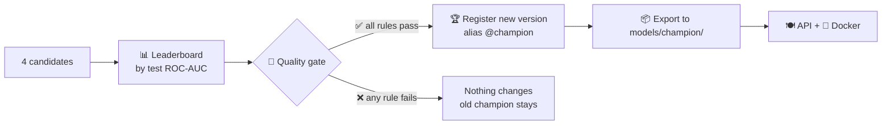
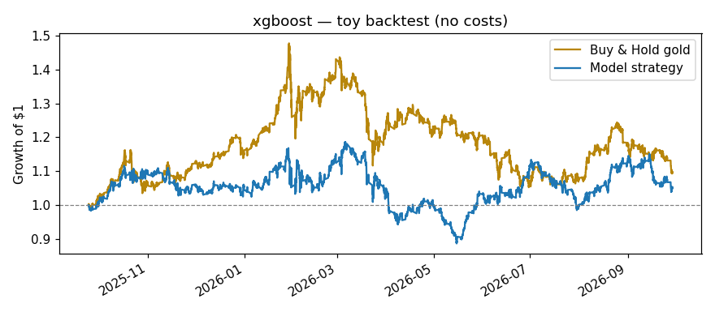
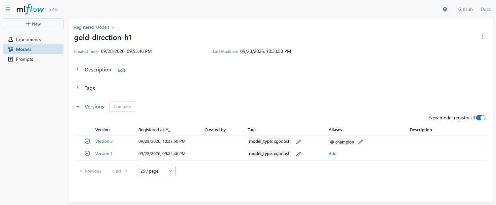

# 06 · Evaluate, quality gate & Model Registry

> 🌐 **English** · [Español](../es/06-evaluate-registry.md) · ⬅️ [05 · Train](05-train-mlflow.md) · ➡️ [07 · API](07-api.md)

| | |
|---|---|
| 🍳 **Analogy** | 🏅 The jury tastes every dish; only the best one goes on the menu |
| 🎯 **Goal** | Promote a model **only** if it's objectively better than guessing |
| 📓 **Notebook** | [`05_evaluate_registry`](../../notebooks/05_evaluate_registry.ipynb) |
| 🏭 **Production code** | [`src/models/promote.py`](../../src/models/promote.py), [`gate.py`](../../src/models/gate.py), [`check_gate.py`](../../src/models/check_gate.py) |

## 🚦 The flow



## 📏 Metrics in plain words

| Metric | Question it answers | Our champion |
|---|---|---|
| **Accuracy** | % of hours where UP/DOWN was right | 51.48% |
| **Precision** | When it says UP, how often is it really UP? | 51.84% |
| **Recall** | Of all real UPs, how many did it catch? | 66.52% |
| **ROC-AUC** | Does it rank "more likely UP" above "less likely UP"? 0.5 = coin | 0.5140 |

## 🚦 The quality gate — written rules, not opinions

Defined in `params.yaml → evaluate`:

```yaml
evaluate:
  primary_metric: roc_auc
  min_roc_auc: 0.51          # must be better than a coin by a minimum margin
  must_beat_baseline: true   # must beat "always UP" in AUC AND accuracy
```

```text
Leaderboard (test_roc_auc):
  1. xgboost              test_roc_auc=0.5140  acc=0.5148
  2. random_forest        test_roc_auc=0.5032  acc=0.5045
  3. logistic_regression  test_roc_auc=0.5028  acc=0.5045
  4. baseline             test_roc_auc=0.5000  acc=0.5092
  ✅ roc_auc >= 0.51
  ✅ beats baseline (roc_auc)
  ✅ beats baseline (accuracy)
🏆 Registered gold-direction-h1 v2 → alias @champion
```

## 💰 The honest truth: beating 50% ≠ making money



Toy strategy (buy if UP, sell if DOWN, **no fees**): **+5.3%**. Simply holding gold: **+9.8%**.
The model is *slightly* better than a coin at predicting direction, but that doesn't mean it's a good trading system. This project is about the **process**.

## 🏆 The Model Registry

Like a library catalog: every approved model gets a **version number**; an **alias** (`@champion`) points to the one in production.



```python
# Load the production model BY NAME — no file paths:
model = mlflow.sklearn.load_model("models:/gold-direction-h1@champion")
```

| Action | How |
|---|---|
| Promote | move `@champion` to the new version (done automatically by `promote.py`) |
| **Rollback** | move `@champion` back to an older version (1 click in the UI) |
| Audit | every version links to its run: params, metrics, charts, git commit |

## 📦 Why also export to `models/champion/`?

The GitHub robot (CD) builds the Docker image but **can't reach your local MLflow**. So the champion is also copied into the repo (371 KB): `model/` (MLflow format) + `metadata.json` (metrics, features, version).

## 🛡️ The gate also runs in CI

`python -m src.models.check_gate` runs on **every push**: if someone commits a champion that doesn't pass the rules, the build turns ❌ red and can't be merged.

---
⬅️ [05 · Train](05-train-mlflow.md) · ➡️ [07 · Model API (FastAPI)](07-api.md)
