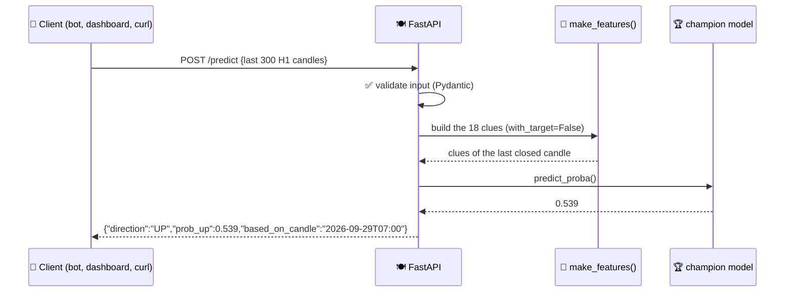
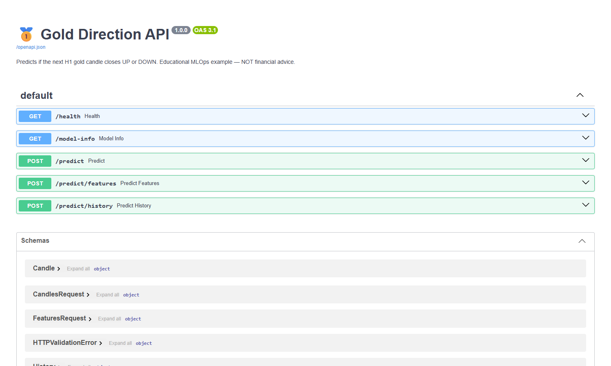

# 07 · Model API (FastAPI)

> 🌐 **English** · [Español](../es/07-api.md) · ⬅️ [06 · Registry](06-evaluate-registry.md) · ➡️ [08 · Docker](08-docker.md)

| | |
|---|---|
| 🍳 **Analogy** | 🧑‍🍳 The waiter: takes orders (requests) and brings back the dish (prediction) |
| 🎯 **Goal** | Let **any** program ask "UP or DOWN?" over HTTP |
| 📓 **Notebook** | [`06_serve_api`](../../notebooks/06_serve_api.ipynb) |
| 🏭 **Production code** | [`src/api/main.py`](../../src/api/main.py), [`src/api/schemas.py`](../../src/api/schemas.py) |
| ▶️ **Run** | `uvicorn src.api.main:app` → http://localhost:8000/docs |

## 🔄 How a prediction travels



## 🚪 Endpoints

| Method | Path | What for |
|---|---|---|
| GET | `/health` | "Are you alive?" (used by Docker healthcheck) |
| GET | `/model-info` | Which model, version, metrics, features |
| POST | `/predict` | Send ≥ 250 candles → UP/DOWN for the **next** hour |
| POST | `/predict/features` | Send the 18 clues directly (advanced) |
| POST | `/predict/history` | P(UP) for **every** candle sent (used by the dashboard charts) |

## 📖 Free interactive documentation (Swagger)

FastAPI builds this page automatically from the code. Click **"Try it out"** to call the API from the browser:



## 💻 Calling it

```powershell
# PowerShell
Invoke-RestMethod http://localhost:8000/health
Invoke-RestMethod http://localhost:8000/model-info
```

```python
# Python
import httpx, pandas as pd
candles = pd.read_csv("data/sample/xauusd_h1_sample.csv").tail(300)
r = httpx.post("http://localhost:8000/predict", json={"candles": candles.to_dict(orient="records")})
print(r.json())   # {'direction': 'DOWN', 'prob_up': 0.452, ...}
```

```powershell
# 🔮 The full live loop: MT5 → API → prediction
python scripts/live_demo.py
```

```text
╔══════════════════════════════════════════════════╗
  🥇 GOLD H1 — next candle prediction
  Last closed candle : 2026-09-29T07:00:00   close=4126.53
  Model              : xgboost v2  (test AUC 0.514)
  Prediction         : 🟢 ▲ UP / SUBE
  Probability UP     : 53.9%
╚══════════════════════════════════════════════════╝
```

## 🛡️ Good practices inside

| Practice | Where |
|---|---|
| **Input validation** (Pydantic): ≥ 250 candles, prices > 0 → clear 422 error, never a crash | `schemas.py` |
| Model loaded **once** at startup, not on every request | `lifespan()` |
| Model location configurable (`MODEL_DIR` env var) | `main.py` |
| **Same feature code** as training (no training/serving skew) | `make_features(with_target=False)` |
| Tests with an in-memory client (`TestClient`) on every push | `tests/test_api.py` |

---
⬅️ [06 · Registry](06-evaluate-registry.md) · ➡️ [08 · Containers (Docker)](08-docker.md)
