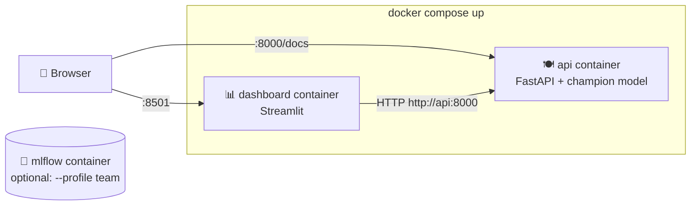

# 08 · Containers (Docker)

> 🌐 **English** · [Español](../es/08-docker.md) · ⬅️ [07 · API](07-api.md) · ➡️ [09 · CI/CD](09-ci-cd.md)

| | |
|---|---|
| 🍳 **Analogy** | 🚚 A food-truck: the whole kitchen (Python, libraries, code, model) packed so it can park anywhere |
| 🎯 **Goal** | Kill "it works on my machine": the same box runs on your PC, in CI and in the cloud |
| 🏭 **Files** | [`Dockerfile`](../../Dockerfile), [`Dockerfile.dashboard`](../../Dockerfile.dashboard), [`docker-compose.yml`](../../docker-compose.yml), [`.dockerignore`](../../.dockerignore) |
| ▶️ **Run** | `docker compose up --build` |

## 📦 Image vs container

| Concept | Analogy | Command |
|---|---|---|
| **Dockerfile** | the recipe to build the truck | — |
| **Image** | the finished truck, parked (read-only) | `docker build` |
| **Container** | the truck **open and serving** | `docker run` |
| **Registry** (ghcr.io) | the parking lot where trucks are shared | `docker push / pull` |
| **Compose** | a fleet of trucks that work together | `docker compose up` |

## 🧱 Our API image, layer by layer

```dockerfile
FROM python:3.12-slim                          # 1. a small Linux + Python
COPY requirements-api.txt .
RUN pip install -r requirements-api.txt        # 2. libraries (cached layer → fast rebuilds)
COPY src/ ... models/champion/ ...             # 3. only the code the API needs + the model
RUN useradd appuser && USER appuser            # 4. don't run as root (security)
HEALTHCHECK ... /health                        # 5. Docker checks it's alive every 30 s
CMD ["uvicorn", "src.api.main:app", ...]       # 6. what runs when the container starts
```

> 💡 **Why is XGBoost `xgboost-cpu` in Linux?** The normal package downloads ~350 MB of NVIDIA GPU libraries we don't use. `xgboost-cpu` keeps images small.

## 🚢 Two containers working together



- Containers find each other **by service name** (`http://api:8000`).
- The dashboard **waits** until the API is healthy (`depends_on: condition: service_healthy`).
- The dashboard never loads the model itself: it asks the API, like any real client.

```powershell
docker compose up --build        # build + start both
docker compose ps                # status (api should say "healthy")
docker compose logs -f api       # live logs
docker compose down              # stop and remove
```

> ⚠️ **Port busy?** `$env:API_PORT=8010; $env:DASHBOARD_PORT=8502; docker compose up`

## ✅ Proof that it's reproducible

The same 300 candles sent to the API **on Windows** and **inside the Linux container** give exactly the same answer:

```text
local (Windows) : {'direction': 'DOWN', 'prob_up': 0.452, 'based_on_candle': '2026-09-29T05:00:00'}
docker (Linux)  : {'direction': 'DOWN', 'prob_up': 0.452, 'based_on_candle': '2026-09-29T05:00:00'}
```

## 🟡 Why isn't MetaTrader 5 in a container?

The `MetaTrader5` package only works on **Windows with the terminal open**; Docker images are Linux.
That's why the **extraction runs on your PC** and everything downstream uses the data versioned by DVC. This separation is common in real life (data sources that only live in one place).

---
⬅️ [07 · API](07-api.md) · ➡️ [09 · CI/CD with GitHub Actions](09-ci-cd.md)
