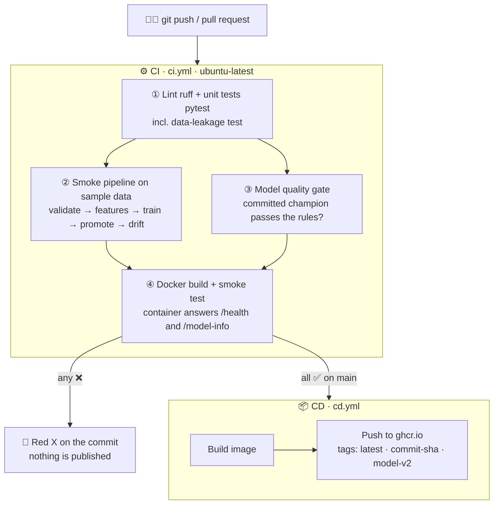
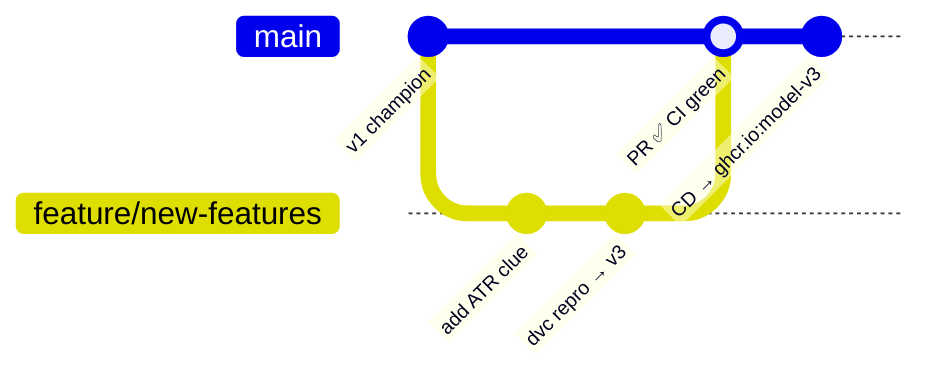

# 09 · CI/CD with GitHub Actions

> 🌐 **English** · [Español](../es/09-ci-cd.md) · ⬅️ [08 · Docker](08-docker.md) · ➡️ [10 · Monitoring](10-monitoring.md)

| | |
|---|---|
| 🍳 **Analogy** | 🕵️ The health inspector checks every change **before** the restaurant opens with it; then 🚚 the new truck is delivered automatically |
| 🎯 **Goal** | Every push is tested automatically; only green changes are published |
| 🏭 **Files** | [`.github/workflows/ci.yml`](../../.github/workflows/ci.yml), [`.github/workflows/cd.yml`](../../.github/workflows/cd.yml) |
| 🌐 **See it** | https://github.com/MirandaCR/GoldMLFlow/actions |

## 🤔 CI vs CD

| | **CI** — Continuous Integration | **CD** — Continuous Delivery |
|---|---|---|
| Question | "Is this change safe?" | "Ship it!" |
| When | every push and pull request | only when CI is ✅ on `main` |
| Does | lint, tests, pipeline, quality gate, Docker build | builds & publishes the Docker image |
| Result | ✅ / ❌ next to each commit | `ghcr.io/mirandacr/goldmlflow:latest` |

## 🔄 The full robot flow



## 🔎 Each CI job in plain words

| Job | What it catches |
|---|---|
| **① Lint & unit tests** | messy code, broken functions, **data leakage**, API errors |
| **② Smoke pipeline** | "the whole pipeline still runs end to end" (on the 4,000-candle sample in Git: the robot has no MT5 and can't reach your local DVC storage) |
| **③ Quality gate** | someone committed a **worse model** than the rules allow |
| **④ Docker build** | the image doesn't build or the container doesn't answer |

Results appear in the job **Summary** (metrics table + champion checks) and artifacts (reports, MLflow runs) can be downloaded.

## 📦 CD: publishing the image

When CI is green on `main`, `cd.yml`:
1. reads the champion version from `models/champion/metadata.json`
2. builds the image and pushes it to **GitHub Container Registry** with 3 tags: `latest`, the commit SHA and `model-v2`
3. anyone can now run it without cloning anything:

```powershell
docker run -p 8000:8000 ghcr.io/mirandacr/goldmlflow:latest
```

> 🔐 No secrets needed: the built-in `GITHUB_TOKEN` has `packages: write` permission (declared in the workflow).
> The first time, the package is **private**; make it public in GitHub → your profile → Packages → goldmlflow → Package settings.

## 🧭 The daily workflow with CI/CD



1. Create a branch, change code/params, `dvc repro`, `dvc push`.
2. `git push` → open a Pull Request → CI runs.
3. ✅ green → merge → CD publishes the new image automatically.

## 💡 Going further (real-world upgrades)

| Upgrade | How |
|---|---|
| CI trains on the **full** data | use a cloud DVC remote (S3/GCS) + `dvc pull` in CI with secrets |
| Retrain on a schedule | add `on: schedule: - cron: "0 6 * * 1"` |
| Comment metrics on the PR | [CML](https://cml.dev) (`cml comment create`) |
| Deploy to a server | after the push, `ssh` / Cloud Run / Kubernetes step |

---
⬅️ [08 · Docker](08-docker.md) · ➡️ [10 · Monitoring & data drift](10-monitoring.md)
