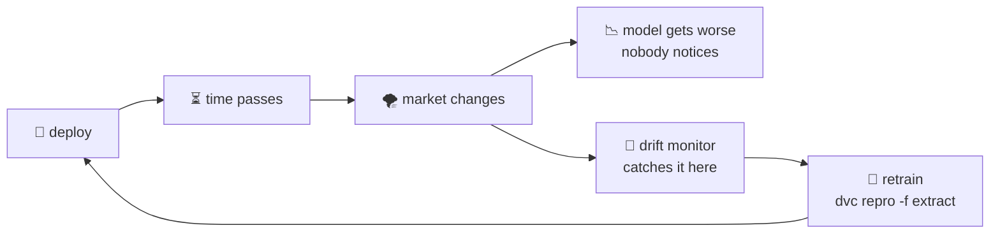
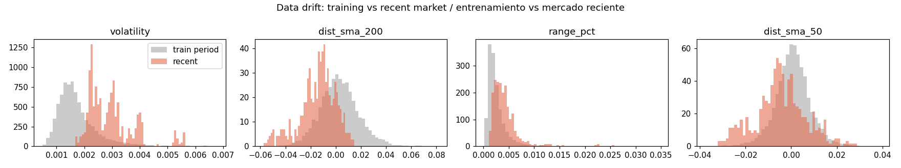
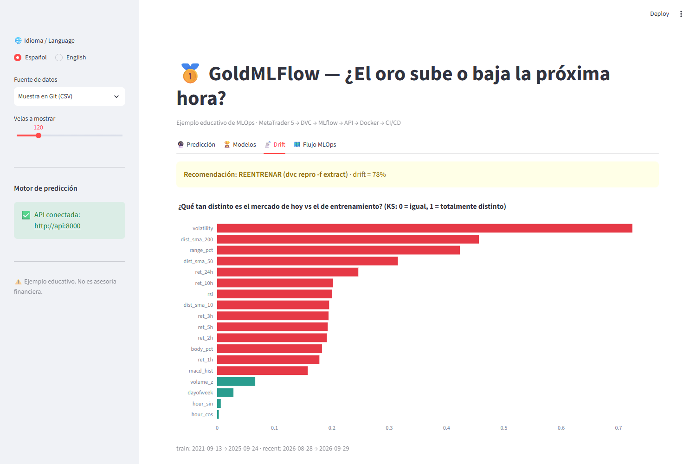

# 10 · Monitoring & data drift

> 🌐 **English** · [Español](../es/10-monitoring.md) · ⬅️ [09 · CI/CD](09-ci-cd.md) · ➡️ [11 · Dashboard](11-dashboard.md)

| | |
|---|---|
| 🍳 **Analogy** | 📋 Checking whether customers still order the same dishes as when you designed the menu |
| 🎯 **Goal** | Detect when today's market no longer looks like the one the model learned from |
| 📓 **Notebook** | [`07_monitor_drift`](../../notebooks/07_monitor_drift.ipynb) |
| 🏭 **Production code** | [`src/monitoring/drift.py`](../../src/monitoring/drift.py) (last DVC stage) |

## 📉 Why models get worse silently



A model learns patterns from a **period**. If the market changes (new volatility regime, crisis, rally), those patterns may stop working. That's **data drift**.

## 📏 How we measure it: the KS test

For each clue we compare two histograms, **training period** vs **last 500 hours**, with the **Kolmogorov–Smirnov** test: a number from **0 (identical) to 1 (totally different)**.



## 🔎 What we found (real data)

| Clue | KS | Meaning |
|---|---|---|
| `volatility` | **0.72** | gold is **much** more volatile now than in most of 2021–2025 |
| `dist_sma_200` | 0.46 | price is far from its long-term average (big rally/pullback) |
| `range_pct` | 0.42 | candles are bigger |
| `hour_sin`, `hour_cos`, `dayofweek` | ~0.00–0.03 | calendar clues don't drift (of course!) |

➡️ **78% of the clues drifted → `retrain_recommended: true`** in `reports/drift.json`.



## 🔁 What to do when it fires

```powershell
dvc repro -f extract     # download fresh candles → the WHOLE pipeline re-runs
dvc push                 # save the new data version
git add dvc.lock models/champion reports && git commit -m "retrain: new data"
git push                 # CI checks it, CD publishes it
```

A new champion is only promoted if it **passes the quality gate**; otherwise the old one stays.

## 💡 Next level

- Run the drift check **on a schedule** (GitHub Actions `schedule:` or Windows Task Scheduler) and send an alert (email/Slack/Telegram).
- Also monitor **performance**: store each live prediction and compare with what really happened (the dashboard's "hit rate in window" does this visually).
- Tools: Evidently, WhyLabs, Arize, Prometheus + Grafana.

---
⬅️ [09 · CI/CD](09-ci-cd.md) · ➡️ [11 · Streamlit dashboard](11-dashboard.md)
