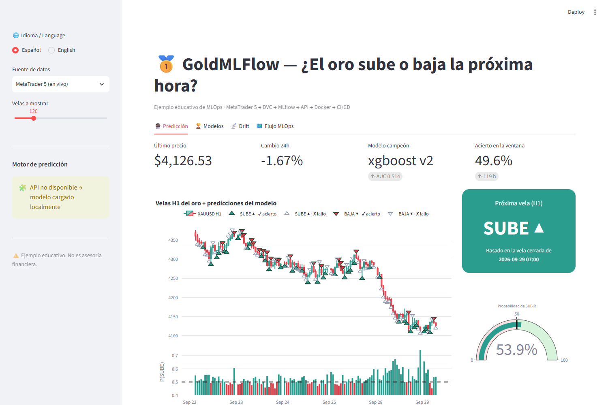
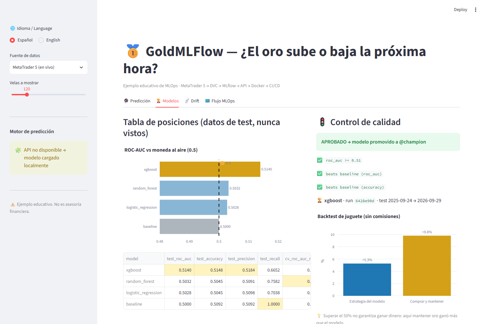
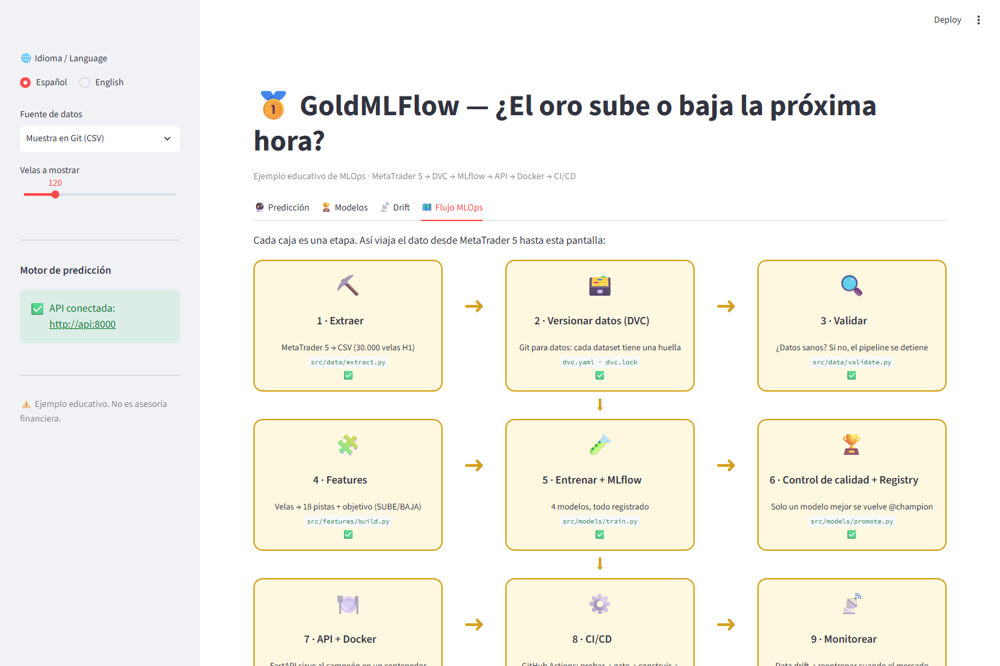
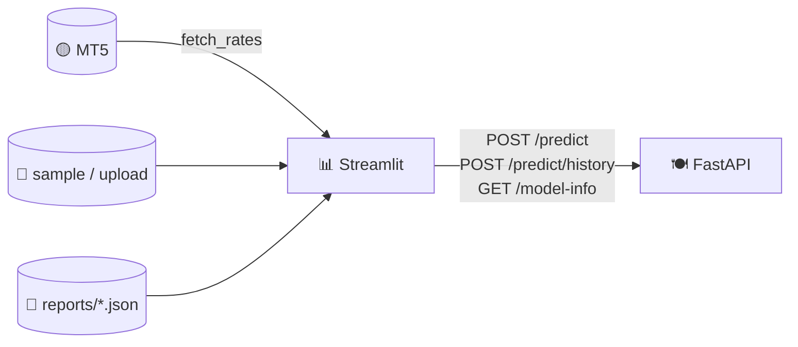

# 11 · Streamlit dashboard — see and use the model

> 🌐 **English** · [Español](../es/11-dashboard.md) · ⬅️ [10 · Monitoring](10-monitoring.md) · ➡️ [12 · Notebook → production](12-notebook-to-production.md)

| | |
|---|---|
| 🍳 **Analogy** | 🪑 The dining room: where customers (non-technical people) see and enjoy the food |
| 🎯 **Goal** | Show the whole project visually to anyone, in Spanish or English |
| 🏭 **Code** | [`app/dashboard.py`](../../app/dashboard.py) |
| ▶️ **Run** | `streamlit run app/dashboard.py` → http://localhost:8501 · or `docker compose up` |

## 🧭 Sidebar

| Control | Options |
|---|---|
| 🌐 Language | Español / English |
| Data source | **MetaTrader 5 (live)** (Windows only) · sample CSV in Git · upload your own CSV |
| Candles to show | 48 – 400 |
| Prediction engine | ✅ API connected → uses the API · otherwise loads the same FastAPI app in-process |

## 🔮 Tab 1 — Prediction

- **Cards**: last price, 24h change, champion model + AUC, **hit rate** of the model on the visible candles.
- **Big card + gauge**: the call for the **next hour** (UP ▲ / DOWN ▼) and its probability.
- **Candlestick chart**: each triangle is what the model said *before* that hour (▲ UP below the candle, ▼ DOWN above). **Coloured = right ✔, hollow grey = wrong ✘**.
- **Bottom bars**: P(UP) per hour; above the dashed 50% line → it said UP.

## 🏆 Tab 2 — Models

Leaderboard vs the 🪙 coin flip, the metrics table, the 🚦 quality-gate result and the toy backtest (model vs buy & hold).

## 📡 Tab 3 — Drift

Which clues changed the most between the training period and today, plus the retrain recommendation (see [chapter 10](10-monitoring.md)).

## 🗺️ Tab 4 — MLOps flow

The 9 stages as boxes: ✅ when that stage's output exists. Perfect to **explain the project to someone who knows nothing about MLOps**, box by box.

## 🧱 How it's built

- The dashboard is a **client** of the API (separation of concerns: UI ≠ model).
- If the API isn't running, it starts the **same** FastAPI app in-process (`TestClient`), so it never duplicates logic.
- It checks `/model-info`, not just `/health`, to make sure the thing on that port is *our* API.

---
⬅️ [10 · Monitoring](10-monitoring.md) · ➡️ [12 · From notebook to production](12-notebook-to-production.md)
