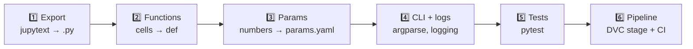

# 12 · From notebook to production code

> 🌐 **English** · [Español](../es/12-notebook-to-production.md) · ⬅️ [11 · Dashboard](11-dashboard.md) · ➡️ [13 · Glossary & FAQ](13-glossary-faq.md)

| | |
|---|---|
| 🍳 **Analogy** | 🧪 A chef experiments freely in the test kitchen (notebook); the winning recipe is then written as a precise card every cook can repeat (`.py`) |
| 🎯 **Goal** | Understand **why and how** each notebook became a production script |

## 🔀 Two worlds, two jobs

| 📓 Notebook | 🏭 `.py` script |
|---|---|
| **Discover**: try, plot, make mistakes | **Repeat**: same result every time |
| Cells run in any order (hidden state!) | Runs top to bottom, always |
| Values typed by hand | Values from `params.yaml` |
| You look at the output | Logs, exit codes, JSON reports |
| Hard to test / review in Git | Unit tests, code review, CI |
| Run by clicking ▶ | Run by DVC, CI, Docker |

## 🗺️ The map of this project

| Notebook | Became | Test |
|---|---|---|
| [`01_extract_mt5`](../../notebooks/01_extract_mt5.ipynb) | [`src/data/extract.py`](../../src/data/extract.py) | — (needs MT5) |
| [`02_validate_explore`](../../notebooks/02_validate_explore.ipynb) | [`src/data/validate.py`](../../src/data/validate.py) | `tests/test_data.py` |
| [`03_features`](../../notebooks/03_features.ipynb) | [`src/features/build.py`](../../src/features/build.py) | `tests/test_features.py` |
| [`04_train_mlflow`](../../notebooks/04_train_mlflow.ipynb) | [`src/models/train.py`](../../src/models/train.py) | CI smoke pipeline |
| [`05_evaluate_registry`](../../notebooks/05_evaluate_registry.ipynb) | [`src/models/promote.py`](../../src/models/promote.py) + `check_gate.py` | CI quality gate |
| [`06_serve_api`](../../notebooks/06_serve_api.ipynb) | [`src/api/main.py`](../../src/api/main.py) + `Dockerfile` | `tests/test_api.py` |
| [`07_monitor_drift`](../../notebooks/07_monitor_drift.ipynb) | [`src/monitoring/drift.py`](../../src/monitoring/drift.py) | CI smoke pipeline |

Every notebook ends with a **"🔁 From notebook to production"** table showing exactly what changed.

## 🪜 The 6 steps (do them in this order)



### 1️⃣ Export the notebook to a plain `.py`

```powershell
jupytext --to py:percent notebooks/03_features.ipynb -o notebooks/exported/03_features.py
```

The results are in [`notebooks/exported/`](../../notebooks/exported/): the notebook as text, with `# %%` marking each cell. **It's a starting point, not production code.**

### 2️⃣ Turn cells into functions

```python
# 📓 notebook cell
X["rsi"] = 100 - 100 / (1 + gain / loss)
```
```python
# 🏭 src/features/build.py
def rsi(close: pd.Series, window: int) -> pd.Series:
    """Relative Strength Index (0-100)."""
    ...
```

### 3️⃣ Move magic numbers to `params.yaml`

```python
for w in [10, 50, 200]:                  # 📓 hard-coded
for w in p["sma_windows"]:               # 🏭 from params.yaml → DVC re-runs when it changes
```

### 4️⃣ Add a command line and logging

```python
parser.add_argument("--input", default=params["features"]["processed_path"])
log.info("%d rows x %d features | saved %s", ...)
```
→ the same script works on the full data (DVC) and on the sample (CI).

### 5️⃣ Write tests for what you checked "by eye"

In notebook 03 we *saw* leakage in a chart → in production `test_no_leakage_features_ignore_the_future` checks it on every push.

### 6️⃣ Plug it into the pipeline

Add a stage to `dvc.yaml` (deps, params, outs) and, if needed, a step in `ci.yml`.

## ✅ Checklist: is my script production-ready?

- [ ] No hidden state: runs top to bottom in a clean terminal
- [ ] No hard-coded paths or numbers → `params.yaml`
- [ ] `if __name__ == "__main__": main()`
- [ ] Clear errors & non-zero exit code on failure
- [ ] At least one test for its critical logic
- [ ] Declared as a DVC stage with deps/outs
- [ ] Passes `ruff check`

---
⬅️ [11 · Dashboard](11-dashboard.md) · ➡️ [13 · Glossary & FAQ](13-glossary-faq.md)
