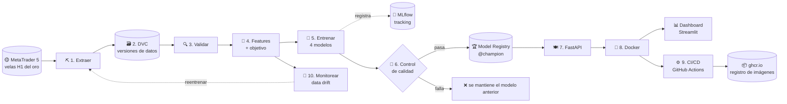

# 00 · La foto completa — ¿Qué es MLOps?

> 🌐 [English](../en/00-big-picture.md) · **Español** · [🏠 README](../../README.es.md) · Siguiente ➡️ [01 · Instalación](01-setup.md)

## 🤔 El problema que resuelve MLOps

Entrenar un modelo en un notebook es como **cocinar un plato espectacular en casa**.
MLOps es **montar un restaurante** que sirve ese plato todos los días, con el mismo sabor, de forma segura y a tiempo, y que cambia la receta cuando cambian los gustos de los clientes.

| En casa (solo un notebook) 🏠 | Restaurante (MLOps) 🍽️ |
|---|---|
| "¿De dónde saqué esos datos?" | Los datos están **versionados** (DVC): puedes volver a cualquier versión |
| "¿Con qué configuración saqué 0,51?" | Cada experimento queda **registrado** (MLflow) |
| "En mi laptop funciona" | Está **empaquetado en un contenedor** (Docker) y corre en cualquier lado |
| "Pasé el modelo por correo" | El modelo se sirve mediante una **API** |
| "Ojalá no haya roto nada" | **Pruebas automáticas** en cada cambio (CI) |
| "Despliego a mano los viernes" | **Entrega automática** cuando las pruebas pasan (CD) |
| "El modelo empeoró… ¿desde cuándo?" | El **monitoreo** avisa cuando el mercado cambia (drift) |

## 🥇 Nuestro ejemplo en una frase

> **Cada hora, predecir si la siguiente vela H1 del oro (XAUUSD) cerrará ARRIBA (1) o ABAJO (0)**, usando datos de MetaTrader 5, y hacer todo lo que la rodea al estilo MLOps.

Es un problema de **clasificación binaria** sobre una **serie de tiempo**.

## 🗺️ El flujo completo



## 🍳 La analogía del restaurante (tenla presente en cada capítulo)

| Etapa | Herramienta | Analogía |
|---|---|---|
| Extraer | MetaTrader 5 + Python | 🛒 Comprar los ingredientes en el mercado |
| Versionar datos | **DVC** | 📸 Fotos con fecha de tu despensa: siempre puedes volver atrás |
| Validar | chequeos con pandas | 🔍 Revisar que los ingredientes no estén podridos |
| Features | pandas | 🔪 Picar y preparar los ingredientes |
| Entrenar | scikit-learn, XGBoost | 👩‍🍳 Probar varias recetas |
| Registrar | **MLflow** | 📒 Un cuaderno de laboratorio donde se anota cada intento |
| Control + registro | **MLflow Model Registry** | 🏅 El jurado elige el plato que entra al menú |
| API | **FastAPI** | 🧑‍🍳 El mesero que toma pedidos y trae el plato |
| Contenedor | **Docker** | 🚚 Un food-truck: toda la cocina lista para estacionarse en cualquier lugar |
| CI/CD | **GitHub Actions** | 🕵️ El inspector de sanidad revisa cada cambio antes de abrir |
| Dashboard | **Streamlit** | 🪑 El comedor donde los clientes ven y disfrutan la comida |
| Monitorear | prueba KS de drift | 📋 Revisar si los clientes siguen pidiendo lo mismo |

## 📂 ¿Dónde está cada pieza?

```text
GoldMLFlow/
├── params.yaml              ← 🎛️ panel de control: toda la configuración vive aquí
├── dvc.yaml / dvc.lock      ← 🗃️ receta del pipeline + foto exacta de cada etapa
├── src/
│   ├── data/extract.py      ← ⛏️ etapa 1
│   ├── data/validate.py     ← 🔍 etapa 3
│   ├── features/build.py    ← 🧩 etapa 4
│   ├── models/train.py      ← 🧪 etapa 5
│   ├── models/promote.py    ← 🚦🏆 etapa 6
│   ├── api/main.py          ← 🍽️ etapa 7
│   └── monitoring/drift.py  ← 📡 etapa 10
├── app/dashboard.py         ← 📊 app de Streamlit
├── notebooks/               ← 📓 exploración (uno por etapa) → se convirtieron en src/*.py
├── tests/                   ← ✅ pruebas automáticas (las ejecuta el CI)
├── Dockerfile(.dashboard), docker-compose.yml  ← 🐳
└── .github/workflows/       ← ⚙️ CI (ci.yml) y CD (cd.yml)
```

## ⚠️ Expectativas honestas

Los movimientos horarios del oro son **casi aleatorios**. Nuestro mejor modelo acierta **~51,5 %** de las veces (el baseline "siempre SUBE" acierta ~50,9 %).
Es normal y **no** es el objetivo: este proyecto enseña el **proceso**. Si algún modelo de trading muestra 90 % de acierto, sospecha de un error (ver [fuga de datos](04-validate-features.md#-fuga-de-datos-data-leakage-la-trampa-1)).

> 📌 Proyecto educativo. **No es asesoría financiera.**

---
➡️ Siguiente: [01 · Instalación y ejecutar todo](01-setup.md)
