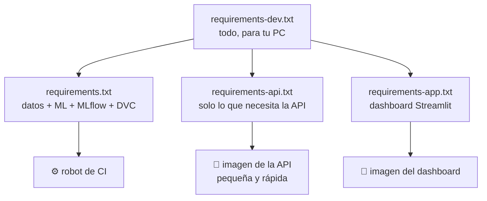

# 01 · Instalación y ejecutar todo

> 🌐 [English](../en/01-setup.md) · **Español** · ⬅️ [00 · Foto completa](00-big-picture.md) · ➡️ [02 · Extraer](02-extract-mt5.md)

| | |
|---|---|
| 🍳 **Analogía** | Preparar la cocina antes de cocinar |
| 🎯 **Objetivo** | Tener listos Python, las librerías, MT5, Docker y Git |
| ⏱️ **Tiempo** | ~15 minutos |

## ✅ Requisitos

| Herramienta | Para qué | Verificar |
|---|---|---|
| **Windows 10/11** | El paquete `MetaTrader5` de Python solo existe para Windows | — |
| **Terminal MetaTrader 5** (abierta y con sesión iniciada; sirve una cuenta demo) | Fuente de los precios del oro | abrir la app |
| **Python 3.11 o 3.12** | Ejecuta todo | `python --version` |
| **Git** | Versiona el código | `git --version` |
| **Docker Desktop** | Contenedores | `docker --version` |
| Cuenta de GitHub | CI/CD | — |

## 🧰 Paso a paso

```powershell
# 1) Descargar el código
git clone https://github.com/MirandaCR/GoldMLFlow.git
cd GoldMLFlow

# 2) Crear un entorno de Python aislado ("una cocina limpia solo para esta receta")
python -m venv .venv
.\.venv\Scripts\Activate.ps1

# 3) Instalar todo (núcleo + API + dashboard + notebooks + pruebas)
pip install -r requirements-dev.txt
```

### 📦 ¿Por qué 4 archivos de requirements?



Cada contenedor instala **solo lo que necesita** → imágenes más pequeñas, rápidas y seguras.

## 🚀 Ejecutar todo el pipeline (un solo comando)

Con MetaTrader 5 **abierto**:

```powershell
dvc repro          # extraer → validar → features → entrenar → promover → drift
```

Verás cada etapa correr en orden. Ejecútalo otra vez y DVC dirá *"didn't change, skipping"*: solo re-ejecuta lo que cambió.

> ⚠️ **Activa siempre el `.venv` primero** (la terminal muestra `(.venv)`). Si usas el Python global verás `ModuleNotFoundError: No module named 'mlflow'`. Atajo para el dashboard: `.\run_dashboard.ps1`.

## 👀 Ver los resultados

```powershell
mlflow ui --backend-store-uri sqlite:///mlflow.db     # 🧪 experimentos → http://localhost:5000
uvicorn src.api.main:app                               # 🍽️ API          → http://localhost:8000/docs
streamlit run app/dashboard.py                         # 📊 dashboard    → http://localhost:8501
docker compose up --build                              # 🐳 API + dashboard en contenedores
python scripts/live_demo.py                            # 🔮 predicción en vivo de MT5 en la terminal
jupyter lab notebooks/                                 # 📓 los notebooks de exploración
pytest                                                 # ✅ pruebas
```

> 💡 **¿El puerto 8000 está ocupado?** (otra app lo usa) → `$env:API_PORT=8010; docker compose up` y usa `http://localhost:8010`.

## 🧪 ¿No tienes MetaTrader 5? (Mac/Linux o sin cuenta)

Todo, salvo la extracción, funciona con la **muestra** guardada en Git (`data/sample/xauusd_h1_sample.csv`, últimas 4.000 velas):

```powershell
python -m src.data.validate  --input data/sample/xauusd_h1_sample.csv
python -m src.features.build --input data/sample/xauusd_h1_sample.csv --output data/processed/features.csv
python -m src.models.train
python -m src.models.promote
```

Eso es exactamente lo que hace el robot de CI en GitHub (Linux, sin MT5).

---
⬅️ [00 · Foto completa](00-big-picture.md) · ➡️ [02 · Extraer de MetaTrader 5](02-extract-mt5.md)
