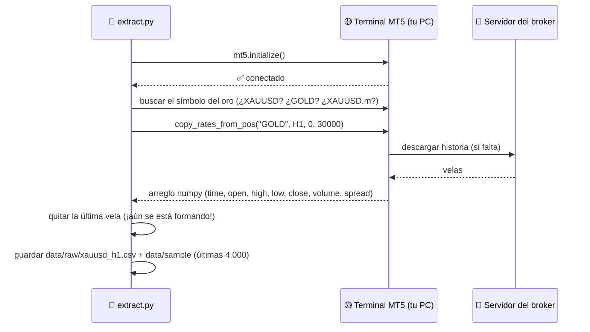
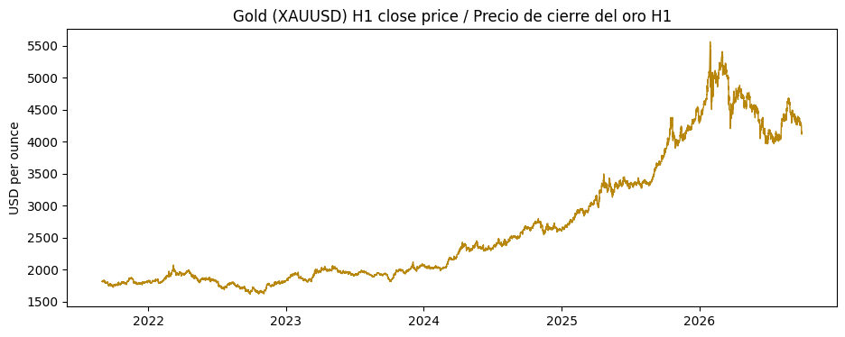

# 02 · Extraer datos del oro desde MetaTrader 5

> 🌐 [English](../en/02-extract-mt5.md) · **Español** · ⬅️ [01 · Instalación](01-setup.md) · ➡️ [03 · DVC](03-dvc.md)

| | |
|---|---|
| 🍳 **Analogía** | 🛒 Ir al mercado a comprar los ingredientes |
| 🎯 **Objetivo** | Descargar velas horarias (H1) del oro a un CSV |
| 📓 **Notebook** | [`notebooks/01_extract_mt5.ipynb`](../../notebooks/01_extract_mt5.ipynb) |
| 🏭 **Código de producción** | [`src/data/extract.py`](../../src/data/extract.py) |
| ▶️ **Ejecutar** | `dvc repro extract` (o `python -m src.data.extract --sample`) |

## 🔌 Cómo funciona



## 🕯️ ¿Qué es una vela?

```text
      high ─┬─          Cada fila = 1 hora de mercado
            │
     ┌──────┴──┐ close   verde: cierre > apertura → el precio SUBIÓ ▲
     │ cuerpo  │         roja:  cierre < apertura → el precio BAJÓ ▼
     └──────┬──┘ open
            │
      low  ─┴─
```

| time | open | high | low | close | volume |
|---|---|---|---|---|---|
| 2021-08-31 18:00 | 1807.03 | 1808.94 | 1804.15 | 1807.78 | 9978 |
| 2021-08-31 19:00 | 1807.86 | 1814.04 | 1807.42 | 1813.83 | 5287 |

## 📊 ¿Cuánta historia hay?

Nuestro broker llama al oro **`GOLD`** y tiene **82.525 velas H1 (junio 2001 → hoy)**.
Usamos las **últimas 30.000 (~5 años: ago 2021 → sep 2026)**.



**¿Por qué no los 25 años?** Los mercados cambian: el oro en 2005 tenía otra volatilidad, liquidez y horarios. Cinco años dan ~30 mil ejemplos y siguen siendo relevantes. Es un parámetro (`params.yaml → data.n_bars`), así que puedes probar con más.

## 🧠 Detalles que importan en producción

| Detalle | Por qué |
|---|---|
| **Detección automática del símbolo** (`symbol_candidates`) | Cada broker llama al oro distinto |
| **Quitar la última vela** | Aún se está formando; su "cierre" va a cambiar → sería una mentira |
| **Hora del servidor del broker** | Las horas de MT5 están en la zona horaria del broker (normalmente GMT+2/+3) |
| **Importar MT5 dentro de la función** | Así el resto del proyecto funciona en Linux (CI/Docker), donde MT5 no existe |
| **Archivo de muestra** (`--sample`) | Una copia pequeña (4.000 velas) guardada en Git para las pruebas del CI |

## 🧪 Pruébalo tú

1. En `params.yaml`, cambia `n_bars: 30000` por `50000` y ejecuta `dvc repro`. ¿Qué re-ejecuta DVC? (Pista: *todo*, porque cambiaron los datos crudos.)
2. Cambia `timeframe: H1` por `H4`. ¿Cuántas velas obtienes? ¿Cómo cambia el acierto?

---
⬅️ [01 · Instalación](01-setup.md) · ➡️ [03 · Control de versiones de datos (DVC)](03-dvc.md)
