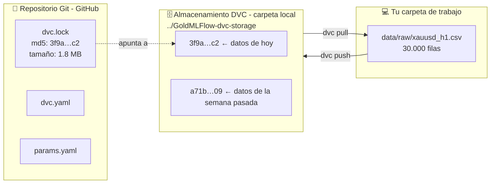
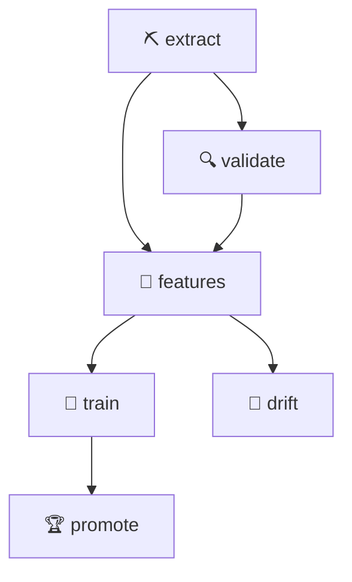

# 03 · Control de versiones de datos (DVC)

> 🌐 [English](../en/03-dvc.md) · **Español** · ⬅️ [02 · Extraer](02-extract-mt5.md) · ➡️ [04 · Validar y features](04-validate-features.md)

| | |
|---|---|
| 🍳 **Analogía** | 📸 Fotos con fecha de tu despensa: siempre puedes volver a la de ayer |
| 🎯 **Objetivo** | Versionar archivos de datos grandes + hacer el pipeline reproducible |
| 🏭 **Archivos** | [`dvc.yaml`](../../dvc.yaml), `dvc.lock`, `.dvc/config`, [`params.yaml`](../../params.yaml) |
| ▶️ **Ejecutar** | `dvc repro`, `dvc push`, `dvc pull`, `dvc dag`, `dvc metrics show` |

## 🤔 ¿Por qué no subir el CSV a Git y ya?

Git es excelente para **código** (archivos de texto pequeños) y malo para **datos** (archivos grandes que cambian completos).
DVC = **"Git para datos"**: Git guarda una *huella* diminuta (hash) del archivo, y el archivo vive en un **almacenamiento** (aquí, una carpeta local).



## 🏗️ Nuestro pipeline (`dvc.yaml`)

Cada **etapa** declara: el comando, de qué **depende** (código, datos, parámetros) y qué **produce**.



(Es lo que imprime `dvc dag`.)

```yaml
  train:
    cmd: python -m src.models.train
    deps:                           # si alguno cambia → se re-ejecuta
      - src/models/train.py
      - data/processed/features.csv
    params:
      - train                       # solo la sección "train:" de params.yaml
    outs:
      - reports/train_results.json
```

### 🧠 La magia: `dvc repro` solo re-ejecuta lo que cambió

| Si cambias… | DVC re-ejecuta… |
|---|---|
| `train.models.xgboost.max_depth` en params.yaml | train → promote |
| `features.rsi_window` | features → train → promote → drift |
| `src/monitoring/drift.py` | solo drift |
| nada | nada (*"didn't change, skipping"*) |

## 📸 `dvc.lock` = la foto exacta

Después de cada ejecución, `dvc.lock` guarda el **md5 de cada entrada y salida**. Haz commit en Git → cualquiera puede reproducir **exactamente** el mismo resultado meses después:

```powershell
git checkout <commit-antiguo>   # código + dvc.lock de ese día
dvc pull                        # los datos de ese día
dvc repro                       # los mismos resultados
```

## 🗄️ Nuestro almacenamiento local

```powershell
dvc remote add -d localstorage ../GoldMLFlow-dvc-storage   # ya configurado en .dvc/config
dvc push      # sube las versiones de datos al almacenamiento
dvc pull      # baja los datos que corresponden al dvc.lock actual
```

> 🏢 En una empresa el almacenamiento sería S3, Google Cloud Storage, Azure Blob o una unidad compartida: solo cambias la URL del remote. Todo lo demás queda igual.

## 🔀 ¿Qué va a Git y qué a DVC?

| Archivo | Dónde | Por qué |
|---|---|---|
| `data/raw/xauusd_h1.csv` (1,8 MB, cambia) | **DVC** | datos grandes |
| `data/processed/features.csv` | **DVC** | datos generados |
| `data/sample/xauusd_h1_sample.csv` (pequeño) | **Git** (`cache: false`) | el CI lo necesita y no puede llegar al almacenamiento local |
| `models/champion/` (371 KB) | **Git** (`cache: false`) | el CD construye la imagen Docker a partir de él |
| `reports/metrics.json` | **Git** (`metrics:`) | comparar ejecuciones con `dvc metrics diff` |

## 🧪 Pruébalo tú

```powershell
dvc dag                       # dibuja el pipeline
dvc metrics show              # métricas actuales
# cambia train.models.xgboost.max_depth a 5 en params.yaml, y luego:
dvc repro
dvc metrics diff              # compara con el último commit
dvc params diff               # qué parámetros cambiaron
```

---
⬅️ [02 · Extraer](02-extract-mt5.md) · ➡️ [04 · Validar y features](04-validate-features.md)
