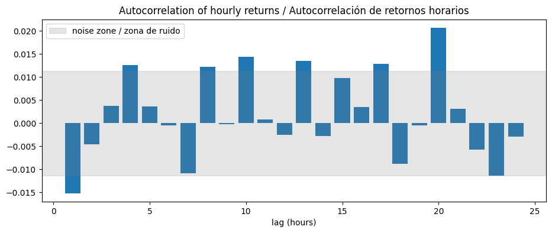
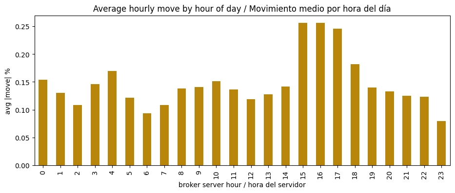
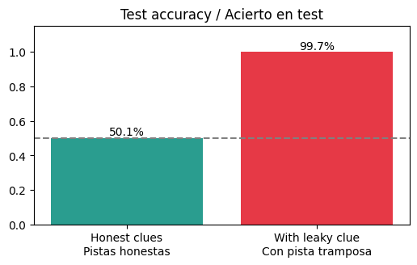

# 04 · Validar datos y construir features

> 🌐 [English](../en/04-validate-features.md) · **Español** · ⬅️ [03 · DVC](03-dvc.md) · ➡️ [05 · Entrenar + MLflow](05-train-mlflow.md)

| | |
|---|---|
| 🍳 **Analogía** | 🔍 Revisar que los ingredientes no estén podridos y luego 🔪 picarlos |
| 🎯 **Objetivo** | Garantizar datos sanos y convertir velas en "pistas" numéricas + la respuesta |
| 📓 **Notebooks** | [`02_validate_explore`](../../notebooks/02_validate_explore.ipynb), [`03_features`](../../notebooks/03_features.ipynb) |
| 🏭 **Código de producción** | [`src/data/validate.py`](../../src/data/validate.py), [`src/features/build.py`](../../src/features/build.py) |
| ✅ **Pruebas** | [`tests/test_data.py`](../../tests/test_data.py), [`tests/test_features.py`](../../tests/test_features.py) |

## Parte A · 🔍 Validación: "basura entra, basura sale"

Antes de que cualquier modelo vea los datos, 8 preguntas de sí/no:

| Chequeo | Detecta… |
|---|---|
| required_columns | una exportación rota |
| enough_rows (≥ 1.000) | MT5 devolvió casi nada |
| no_missing_values | celdas vacías |
| no_duplicated_timestamps | la misma hora dos veces |
| time_is_sorted | filas desordenadas |
| prices_positive | precios en cero o negativos |
| high_is_highest / low_is_lowest | velas imposibles |

Si **cualquiera** falla → el script termina con código 1 → **DVC detiene el pipeline**. Ningún modelo se entrena con datos rotos.

```text
✅ required_columns   ✅ enough_rows   ✅ no_missing_values   ✅ no_duplicated_timestamps
✅ time_is_sorted     ✅ prices_positive   ✅ high_is_highest   ✅ low_is_lowest
Data validation passed (29999 rows)
```

### 🔎 Lo que nos enseñó explorar los datos

| Hallazgo | Gráfico | Consecuencia |
|---|---|---|
| SUBE 50,9 % / BAJA 49,1 % | — | "Siempre SUBE" ya acierta 50,9 % → ese es el **baseline a vencer** |
| Los retornos horarios casi no se relacionan con el pasado |  | Espera ~51–53 %, no 90 % |
| El oro se mueve más en la apertura de Londres y Nueva York |  | Darle al modelo la **hora del día** |

## Parte B · 🧩 Features: convertir velas en pistas

Un modelo no sabe leer un gráfico. Para cada vela *t* calculamos números que describen **solo el pasado**, más el **objetivo (target)**:

```text
 vela t-200 … t-1, t   ──▶   pistas(t)   ──▶  🤖  ──▶  ¿la vela t+1 cerrará más arriba?
     (solo el PASADO)                                   target = 1 (SUBE) / 0 (BAJA)
```

| Familia | Pistas | En palabras simples |
|---|---|---|
| 🏃 Momentum | `ret_1h, ret_2h, ret_3h, ret_5h, ret_10h, ret_24h` | ¿Cuánto se movió el precio en las últimas N horas? |
| 📈 Tendencia | `dist_sma_10, dist_sma_50, dist_sma_200` | ¿Está el precio sobre o bajo su promedio? |
| 🎚️ Osciladores | `rsi`, `macd_hist` | ¿Está "cansado" de subir o bajar? |
| 🌪️ Riesgo | `volatility`, `range_pct`, `body_pct` | ¿Qué tan nervioso está el mercado? |
| 📊 Actividad | `volume_z` | ¿Hay actividad inusual? |
| 🕐 Calendario | `hour_sin, hour_cos, dayofweek` | ¿Asia? ¿Londres? ¿Nueva York? ¿Viernes? |

**Resultado:** 29.799 filas × 18 pistas + objetivo.

> 🕐 **¿Por qué seno/coseno para la hora?** Para un modelo, 23:00 y 00:00 parecen lejanas (23 vs 0), pero son vecinas. Poner las horas en un círculo lo resuelve.

## 🚨 Fuga de datos (data leakage): la trampa #1

**Fuga = una pista que sin querer contiene información del futuro.** En el papel el modelo parece un genio; en la vida real pierde dinero, porque en tiempo real el futuro todavía no existe.

En el notebook 03 agregamos una pista de apariencia inocente: una media móvil **centrada** en la vela (promedia la hora anterior, la actual… **y la siguiente**):



**50,1 % → 99,7 %** con una sola línea de código. **Si los resultados parecen demasiado buenos para ser verdad, es que no lo son.**

### 🛡️ Cómo nos protege producción

```python
def test_no_leakage_features_ignore_the_future(sample_raw, params):
    """Cambiar precios FUTUROS no debe cambiar las pistas de hoy."""
    base = make_features(sample_raw, ...)
    tampered = sample_raw.copy()
    tampered.loc[últimas 100 filas, precios] *= 1.5     # 🔨 cambiamos el futuro
    after = make_features(tampered, ...)
    assert pistas de las filas anteriores idénticas      # ✅ o el CI falla
```

Esta prueba corre en **cada push** en GitHub Actions.

## ♻️ El mismo código para entrenar y para servir

```python
make_features(df, params, with_target=True)   # entrenamiento: agrega target, quita la última vela (sin futuro aún)
make_features(df, params, with_target=False)  # API: mismas pistas, conserva la última vela para predecirla
```

Usar **una sola función** en ambos lados evita el *training/serving skew* (que la API calcule las pistas un poco distinto que el entrenamiento → errores silenciosos).

---
⬅️ [03 · DVC](03-dvc.md) · ➡️ [05 · Entrenar modelos + MLflow](05-train-mlflow.md)
