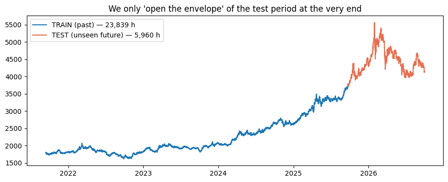
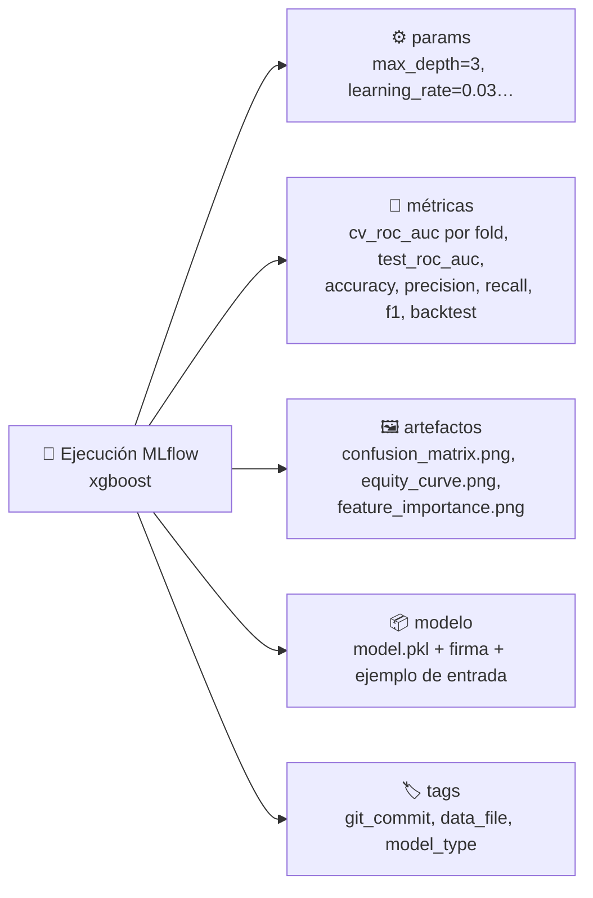
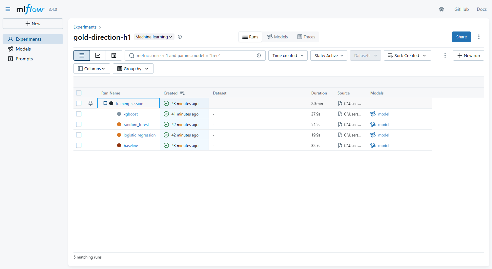
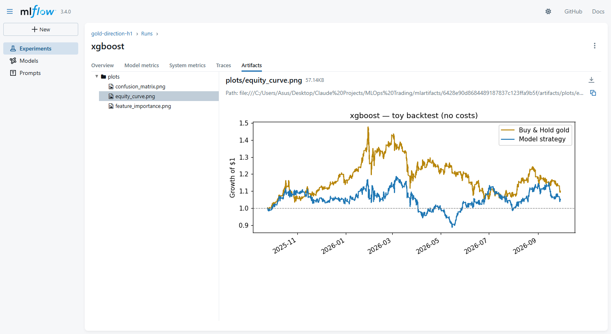
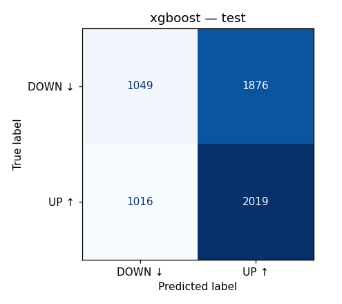
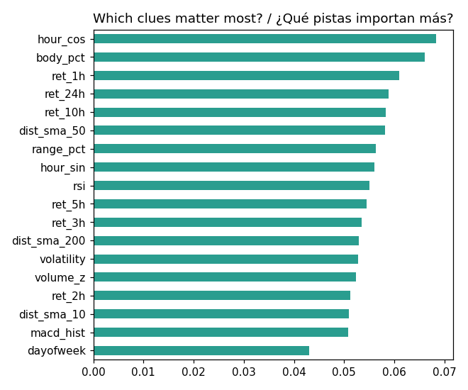
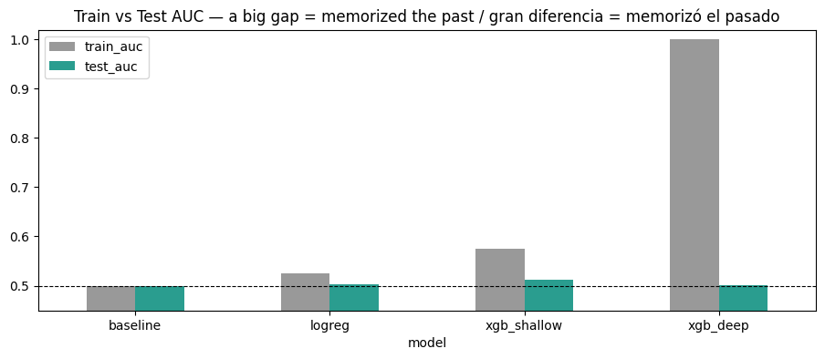

# 05 · Entrenar modelos y registrarlos con MLflow

> 🌐 [English](../en/05-train-mlflow.md) · **Español** · ⬅️ [04 · Features](04-validate-features.md) · ➡️ [06 · Evaluar y registry](06-evaluate-registry.md)

| | |
|---|---|
| 🍳 **Analogía** | 👩‍🍳 Probar varias recetas y 📒 anotarlo todo en un cuaderno de laboratorio |
| 🎯 **Objetivo** | Comparar modelos de forma justa y no perder nunca un resultado |
| 📓 **Notebook** | [`04_train_mlflow`](../../notebooks/04_train_mlflow.ipynb) |
| 🏭 **Código de producción** | [`src/models/train.py`](../../src/models/train.py), [`src/models/tracking.py`](../../src/models/tracking.py) |
| ▶️ **Ejecutar** | `dvc repro train` · Interfaz: `mlflow ui --backend-store-uri sqlite:///mlflow.db` |

## ⏳ Regla #1 en series de tiempo: nunca mezclar

```text
|■■■■■■■■■■■■■■■■■■■■■■ TRAIN 80 % (pasado) ■■■■■■■■■■■■■■■■■■■■■■|□□□ TEST 20 % (futuro no visto) □□□|
 2021-09-13 ────────────────────────────────────────────── 2025-09-24 ──────────────────── 2026-09-29
             23.839 horas                                                5.960 horas
```



Dentro de la parte de entrenamiento usamos **validación cruzada walk-forward** (`TimeSeriesSplit`): "exámenes de práctica" que siempre entrenan con el pasado y prueban con lo que viene después.

```text
fold 1: ▓▓▓░
fold 2: ▓▓▓▓▓░
fold 3: ▓▓▓▓▓▓▓░          ▓ = entrenar   ░ = validar
fold 4: ▓▓▓▓▓▓▓▓▓░
fold 5: ▓▓▓▓▓▓▓▓▓▓▓░
```

## 🤖 Los 4 concursantes

| Modelo | Idea | Por qué está aquí |
|---|---|---|
| **baseline** (`DummyClassifier`) | siempre dice la respuesta más común (SUBE) | 🪙 la "moneda al aire" que todos deben vencer |
| **logistic_regression** | una suma ponderada de las pistas | simple, rápida, difícil de sobreajustar |
| **random_forest** | 300 árboles de decisión votan | capta patrones no lineales |
| **xgboost** | árboles que corrigen los errores de los anteriores | suele ser el más fuerte en datos tabulares |

Cada modelo es un **`Pipeline`** de sklearn (p. ej. escalador + modelo), así el preprocesamiento **viaja junto al modelo** hasta la API.

## 📒 Lo que MLflow registra de cada modelo



Las ejecuciones están **anidadas**: una ejecución padre `training-session` con una hija por modelo.



### 🖼️ Gráficos guardados dentro de cada ejecución



| Matriz de confusión | Importancia de las pistas |
|---|---|
|  |  |

### ✍️ La "firma" (signature): el contrato del modelo

MLflow guarda qué columnas (y de qué tipo) entran y qué sale. Si alguien después envía columnas equivocadas, MLflow avisa en lugar de predecir basura en silencio.

## 📊 Resultados (test = los últimos 12 meses, nunca vistos)

| Modelo | ROC-AUC test | accuracy test |
|---|---|---|
| 🥇 **xgboost** | **0,5140** | **51,48 %** |
| random_forest | 0,5032 | 50,45 % |
| logistic_regression | 0,5028 | 50,45 % |
| baseline 🪙 | 0,5000 | 50,92 % |

## 🎓 Lección del notebook: sobreajuste (overfitting)



`xgb_deep` (8 niveles de profundidad) saca **0,999 de AUC en el pasado** pero **0,501 en el futuro**: **memorizó ruido**. En mercados ruidosos los modelos simples generalizan mejor.

## 🗂️ ¿Dónde se guardan los datos de MLflow?

| Modo | Cómo | Uso |
|---|---|---|
| **Local (por defecto)** | `mlflow.db` (SQLite) + carpeta `mlartifacts/` | aprender, una persona |
| **Equipo** | `docker compose --profile team up mlflow` + `$env:MLFLOW_TRACKING_URI="http://localhost:5000"` | un servidor compartido para todos |

---
⬅️ [04 · Features](04-validate-features.md) · ➡️ [06 · Evaluar, control de calidad y registry](06-evaluate-registry.md)
