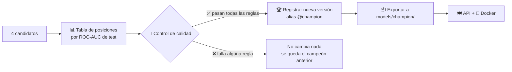
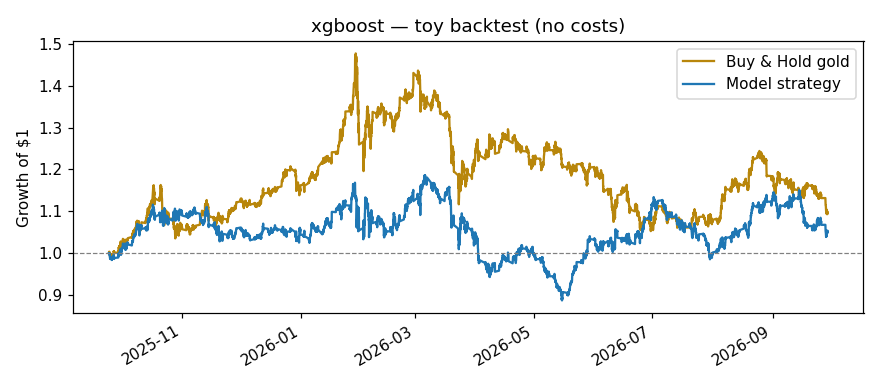
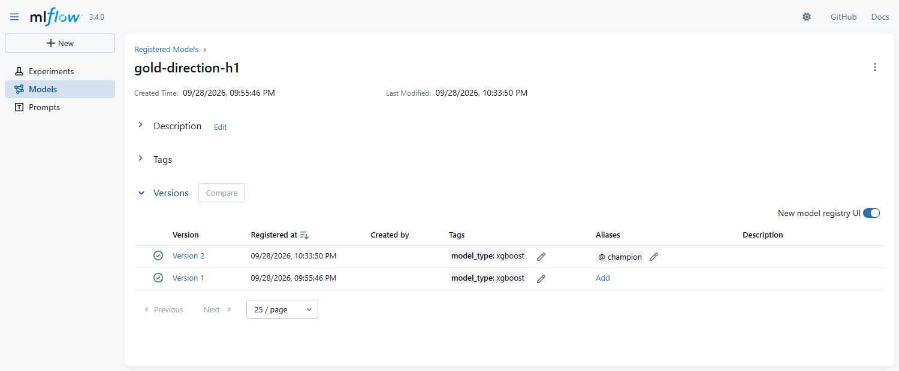

# 06 · Evaluar, control de calidad y Registro de Modelos

> 🌐 [English](../en/06-evaluate-registry.md) · **Español** · ⬅️ [05 · Entrenar](05-train-mlflow.md) · ➡️ [07 · API](07-api.md)

| | |
|---|---|
| 🍳 **Analogía** | 🏅 El jurado prueba cada plato; solo el mejor entra al menú |
| 🎯 **Objetivo** | Promover un modelo **solo** si es objetivamente mejor que adivinar |
| 📓 **Notebook** | [`05_evaluate_registry`](../../notebooks/05_evaluate_registry.ipynb) |
| 🏭 **Código de producción** | [`src/models/promote.py`](../../src/models/promote.py), [`gate.py`](../../src/models/gate.py), [`check_gate.py`](../../src/models/check_gate.py) |

## 🚦 El flujo



## 📏 Métricas en palabras simples

| Métrica | Pregunta que responde | Nuestro campeón |
|---|---|---|
| **Accuracy** | % de horas en que acertó SUBE/BAJA | 51,48 % |
| **Precision** | Cuando dice SUBE, ¿cuántas veces sube de verdad? | 51,84 % |
| **Recall** | De todas las subidas reales, ¿cuántas detectó? | 66,52 % |
| **ROC-AUC** | ¿Ordena "más probable que suba" por encima de "menos probable"? 0,5 = moneda | 0,5140 |

## 🚦 El control de calidad: reglas escritas, no opiniones

Definido en `params.yaml → evaluate`:

```yaml
evaluate:
  primary_metric: roc_auc
  min_roc_auc: 0.51          # debe ser mejor que una moneda por un margen mínimo
  must_beat_baseline: true   # debe vencer a "siempre SUBE" en AUC Y en accuracy
```

```text
Leaderboard (test_roc_auc):
  1. xgboost              test_roc_auc=0.5140  acc=0.5148
  2. random_forest        test_roc_auc=0.5032  acc=0.5045
  3. logistic_regression  test_roc_auc=0.5028  acc=0.5045
  4. baseline             test_roc_auc=0.5000  acc=0.5092
  ✅ roc_auc >= 0.51
  ✅ beats baseline (roc_auc)
  ✅ beats baseline (accuracy)
🏆 Registered gold-direction-h1 v2 → alias @champion
```

## 💰 La verdad honesta: superar el 50 % ≠ ganar dinero



Estrategia de juguete (comprar si dice SUBE, vender si dice BAJA, **sin comisiones**): **+5,3 %**. Simplemente mantener oro: **+9,8 %**.
El modelo es *un poco* mejor que una moneda para predecir la dirección, pero eso no lo convierte en un buen sistema de trading. Este proyecto trata del **proceso**.

## 🏆 El Registro de Modelos (Model Registry)

Como el catálogo de una biblioteca: cada modelo aprobado recibe un **número de versión**, y un **alias** (`@champion`) apunta al que está en producción.



```python
# Cargar el modelo de producción POR NOMBRE, sin rutas de archivos:
model = mlflow.sklearn.load_model("models:/gold-direction-h1@champion")
```

| Acción | Cómo |
|---|---|
| Promover | mover `@champion` a la nueva versión (lo hace `promote.py` automáticamente) |
| **Volver atrás (rollback)** | mover `@champion` a una versión anterior (1 clic en la interfaz) |
| Auditar | cada versión enlaza a su ejecución: params, métricas, gráficos, commit de git |

## 📦 ¿Por qué además exportar a `models/champion/`?

El robot de GitHub (CD) construye la imagen Docker pero **no puede llegar a tu MLflow local**. Por eso el campeón también se copia al repositorio (371 KB): `model/` (formato MLflow) + `metadata.json` (métricas, pistas, versión).

## 🛡️ El control de calidad también corre en el CI

`python -m src.models.check_gate` corre en **cada push**: si alguien sube un campeón que no cumple las reglas, el build queda ❌ rojo y no se puede fusionar.

---
⬅️ [05 · Entrenar](05-train-mlflow.md) · ➡️ [07 · API del modelo (FastAPI)](07-api.md)
