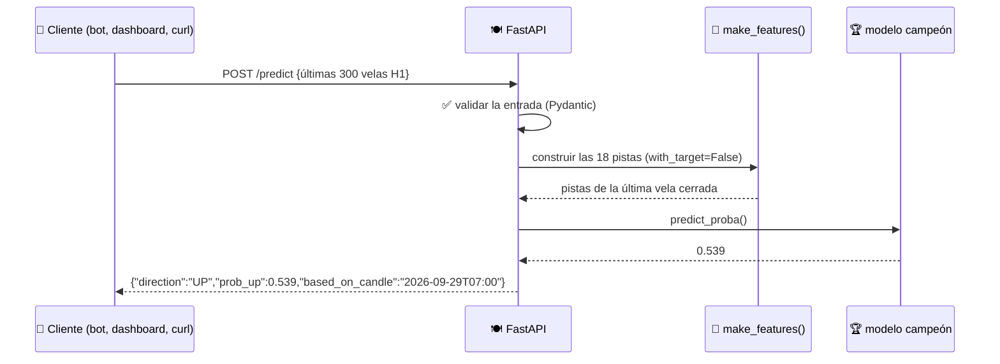
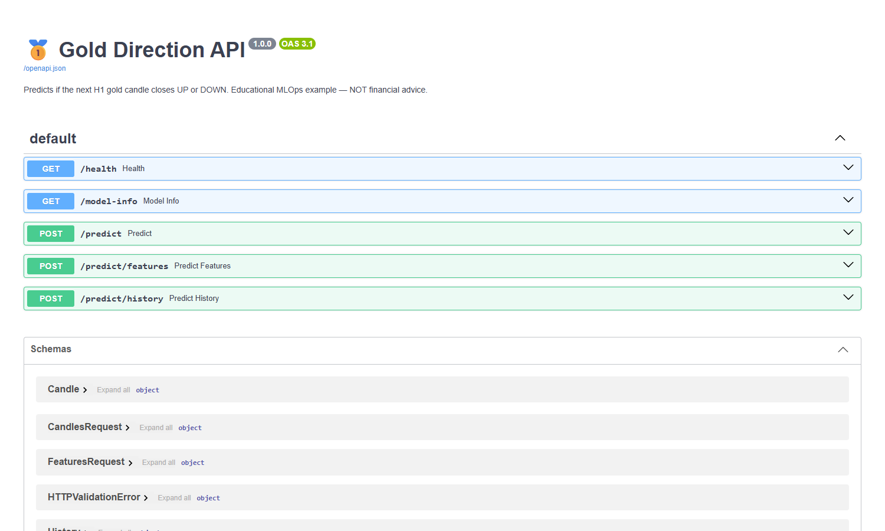

# 07 · API del modelo (FastAPI)

> 🌐 [English](../en/07-api.md) · **Español** · ⬅️ [06 · Registry](06-evaluate-registry.md) · ➡️ [08 · Docker](08-docker.md)

| | |
|---|---|
| 🍳 **Analogía** | 🧑‍🍳 El mesero: toma los pedidos (peticiones) y trae el plato (predicción) |
| 🎯 **Objetivo** | Que **cualquier** programa pregunte "¿SUBE o BAJA?" por HTTP |
| 📓 **Notebook** | [`06_serve_api`](../../notebooks/06_serve_api.ipynb) |
| 🏭 **Código de producción** | [`src/api/main.py`](../../src/api/main.py), [`src/api/schemas.py`](../../src/api/schemas.py) |
| ▶️ **Ejecutar** | `uvicorn src.api.main:app` → http://localhost:8000/docs |

## 🔄 El viaje de una predicción



## 🚪 Endpoints

| Método | Ruta | Para qué |
|---|---|---|
| GET | `/health` | "¿Estás vivo?" (lo usa el healthcheck de Docker) |
| GET | `/model-info` | Qué modelo, versión, métricas y pistas |
| POST | `/predict` | Envía ≥ 250 velas → SUBE/BAJA para la **próxima** hora |
| POST | `/predict/features` | Envía las 18 pistas directamente (uso avanzado) |
| POST | `/predict/history` | P(SUBE) para **cada** vela enviada (lo usan los gráficos del dashboard) |

## 📖 Documentación interactiva gratis (Swagger)

FastAPI genera esta página automáticamente a partir del código. Haz clic en **"Try it out"** para llamar a la API desde el navegador:



## 💻 Cómo llamarla

```powershell
# PowerShell
Invoke-RestMethod http://localhost:8000/health
Invoke-RestMethod http://localhost:8000/model-info
```

```python
# Python
import httpx, pandas as pd
candles = pd.read_csv("data/sample/xauusd_h1_sample.csv").tail(300)
r = httpx.post("http://localhost:8000/predict", json={"candles": candles.to_dict(orient="records")})
print(r.json())   # {'direction': 'DOWN', 'prob_up': 0.452, ...}
```

```powershell
# 🔮 El ciclo completo en vivo: MT5 → API → predicción
python scripts/live_demo.py
```

```text
╔══════════════════════════════════════════════════╗
  🥇 GOLD H1 — next candle prediction
  Last closed candle : 2026-09-29T07:00:00   close=4126.53
  Model              : xgboost v2  (test AUC 0.514)
  Prediction         : 🟢 ▲ UP / SUBE
  Probability UP     : 53.9%
╚══════════════════════════════════════════════════╝
```

## 🛡️ Buenas prácticas incluidas

| Práctica | Dónde |
|---|---|
| **Validación de entrada** (Pydantic): ≥ 250 velas, precios > 0 → error 422 claro, nunca una caída | `schemas.py` |
| Modelo cargado **una vez** al iniciar, no en cada petición | `lifespan()` |
| Ubicación del modelo configurable (variable `MODEL_DIR`) | `main.py` |
| **El mismo código de features** que el entrenamiento (sin training/serving skew) | `make_features(with_target=False)` |
| Pruebas con un cliente en memoria (`TestClient`) en cada push | `tests/test_api.py` |

---
⬅️ [06 · Registry](06-evaluate-registry.md) · ➡️ [08 · Contenedores (Docker)](08-docker.md)
