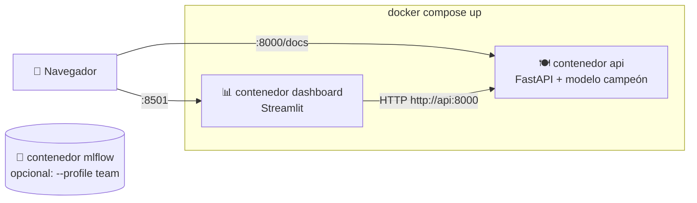

# 08 · Contenedores (Docker)

> 🌐 [English](../en/08-docker.md) · **Español** · ⬅️ [07 · API](07-api.md) · ➡️ [09 · CI/CD](09-ci-cd.md)

| | |
|---|---|
| 🍳 **Analogía** | 🚚 Un food-truck: toda la cocina (Python, librerías, código, modelo) empacada para estacionarse en cualquier lugar |
| 🎯 **Objetivo** | Acabar con el "en mi máquina funciona": la misma caja corre en tu PC, en el CI y en la nube |
| 🏭 **Archivos** | [`Dockerfile`](../../Dockerfile), [`Dockerfile.dashboard`](../../Dockerfile.dashboard), [`docker-compose.yml`](../../docker-compose.yml), [`.dockerignore`](../../.dockerignore) |
| ▶️ **Ejecutar** | `docker compose up --build` |

## 📦 Imagen vs contenedor

| Concepto | Analogía | Comando |
|---|---|---|
| **Dockerfile** | la receta para construir el camión | — |
| **Imagen** | el camión terminado, estacionado (solo lectura) | `docker build` |
| **Contenedor** | el camión **abierto y atendiendo** | `docker run` |
| **Registry** (ghcr.io) | el estacionamiento donde se comparten los camiones | `docker push / pull` |
| **Compose** | una flota de camiones que trabajan juntos | `docker compose up` |

## 🧱 Nuestra imagen de la API, capa por capa

```dockerfile
FROM python:3.12-slim                          # 1. un Linux pequeño + Python
COPY requirements-api.txt .
RUN pip install -r requirements-api.txt        # 2. librerías (capa cacheada → builds rápidos)
COPY src/ ... models/champion/ ...             # 3. solo el código que la API necesita + el modelo
RUN useradd appuser && USER appuser            # 4. no correr como root (seguridad)
HEALTHCHECK ... /health                        # 5. Docker revisa que esté vivo cada 30 s
CMD ["uvicorn", "src.api.main:app", ...]       # 6. lo que corre al iniciar el contenedor
```

> 💡 **¿Por qué XGBoost es `xgboost-cpu` en Linux?** El paquete normal descarga ~350 MB de librerías de GPU de NVIDIA que no usamos. `xgboost-cpu` mantiene las imágenes pequeñas.

## 🚢 Dos contenedores trabajando juntos



- Los contenedores se encuentran **por el nombre del servicio** (`http://api:8000`).
- El dashboard **espera** a que la API esté sana (`depends_on: condition: service_healthy`).
- El dashboard nunca carga el modelo por su cuenta: se lo pregunta a la API, como cualquier cliente real.

```powershell
docker compose up --build        # construir + iniciar ambos
docker compose ps                # estado (la api debe decir "healthy")
docker compose logs -f api       # logs en vivo
docker compose down              # detener y eliminar
```

> ⚠️ **¿Puerto ocupado?** `$env:API_PORT=8010; $env:DASHBOARD_PORT=8502; docker compose up`

## ✅ Prueba de que es reproducible

Las mismas 300 velas enviadas a la API **en Windows** y **dentro del contenedor Linux** dan exactamente la misma respuesta:

```text
local (Windows) : {'direction': 'DOWN', 'prob_up': 0.452, 'based_on_candle': '2026-09-29T05:00:00'}
docker (Linux)  : {'direction': 'DOWN', 'prob_up': 0.452, 'based_on_candle': '2026-09-29T05:00:00'}
```

## 🟡 ¿Por qué MetaTrader 5 no está en un contenedor?

El paquete `MetaTrader5` solo funciona en **Windows con la terminal abierta**, y las imágenes Docker son Linux.
Por eso la **extracción corre en tu PC** y todo lo que viene después usa los datos versionados con DVC. Esta separación es común en la vida real (fuentes de datos que solo viven en un lugar).

---
⬅️ [07 · API](07-api.md) · ➡️ [09 · CI/CD con GitHub Actions](09-ci-cd.md)
