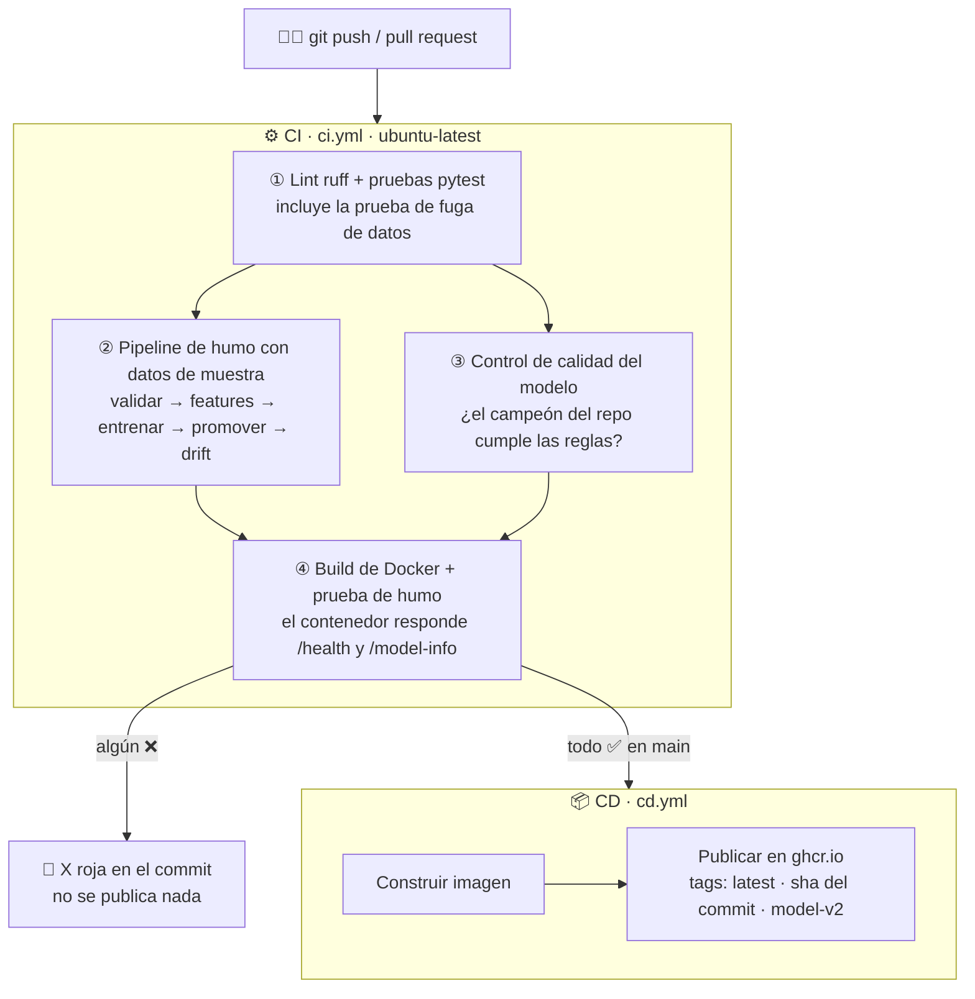
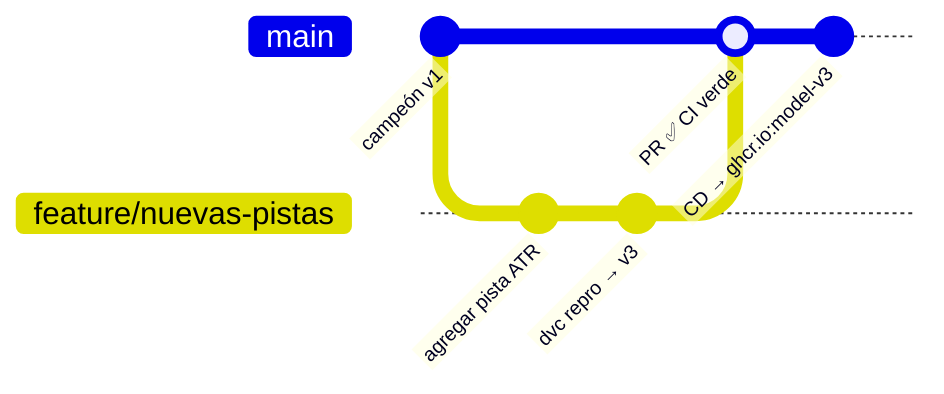

# 09 · CI/CD con GitHub Actions

> 🌐 [English](../en/09-ci-cd.md) · **Español** · ⬅️ [08 · Docker](08-docker.md) · ➡️ [10 · Monitoreo](10-monitoring.md)

| | |
|---|---|
| 🍳 **Analogía** | 🕵️ El inspector de sanidad revisa cada cambio **antes** de que el restaurante abra con él; luego 🚚 el camión nuevo se entrega automáticamente |
| 🎯 **Objetivo** | Cada push se prueba solo; solo los cambios en verde se publican |
| 🏭 **Archivos** | [`.github/workflows/ci.yml`](../../.github/workflows/ci.yml), [`.github/workflows/cd.yml`](../../.github/workflows/cd.yml) |
| 🌐 **Verlo** | https://github.com/MirandaCR/GoldMLFlow/actions |

## 🤔 CI vs CD

| | **CI**: Integración Continua | **CD**: Entrega Continua |
|---|---|---|
| Pregunta | "¿Este cambio es seguro?" | "¡Publícalo!" |
| Cuándo | en cada push y pull request | solo cuando el CI está ✅ en `main` |
| Hace | lint, pruebas, pipeline, control de calidad, build de Docker | construye y publica la imagen Docker |
| Resultado | ✅ / ❌ junto a cada commit | `ghcr.io/mirandacr/goldmlflow:latest` |

## 🔄 El flujo completo del robot



## 🔎 Cada trabajo del CI en palabras simples

| Trabajo | Qué detecta |
|---|---|
| **① Lint y pruebas** | código desordenado, funciones rotas, **fuga de datos**, errores de la API |
| **② Pipeline de humo** | "todo el pipeline sigue corriendo de punta a punta" (con la muestra de 4.000 velas en Git: el robot no tiene MT5 ni acceso a tu almacenamiento DVC local) |
| **③ Control de calidad** | alguien subió un **modelo peor** de lo que permiten las reglas |
| **④ Build de Docker** | la imagen no se construye o el contenedor no responde |

Los resultados aparecen en el **Summary** del trabajo (tabla de métricas + chequeos del campeón) y se pueden descargar los artefactos (reportes, ejecuciones de MLflow).

## 📦 CD: publicar la imagen

Cuando el CI está en verde en `main`, `cd.yml`:
1. lee la versión del campeón en `models/champion/metadata.json`
2. construye la imagen y la sube al **GitHub Container Registry** con 3 tags: `latest`, el SHA del commit y `model-v2`
3. cualquiera puede ejecutarla sin clonar nada:

```powershell
docker run -p 8000:8000 ghcr.io/mirandacr/goldmlflow:latest
```

> 🔐 No hacen falta secretos: el `GITHUB_TOKEN` integrado tiene permiso `packages: write` (declarado en el workflow).
> La primera vez el paquete es **privado**; hazlo público en GitHub → tu perfil → Packages → goldmlflow → Package settings.

## 🧭 El día a día con CI/CD



1. Crea una rama, cambia código o parámetros, `dvc repro`, `dvc push`.
2. `git push` → abre un Pull Request → corre el CI.
3. ✅ verde → fusionar → el CD publica la nueva imagen automáticamente.

## 💡 Para ir más allá (mejoras del mundo real)

| Mejora | Cómo |
|---|---|
| El CI entrena con **todos** los datos | usar un remote DVC en la nube (S3/GCS) + `dvc pull` en el CI con secretos |
| Reentrenar de forma programada | agregar `on: schedule: - cron: "0 6 * * 1"` |
| Comentar métricas en el PR | [CML](https://cml.dev) (`cml comment create`) |
| Desplegar en un servidor | después del push, un paso `ssh` / Cloud Run / Kubernetes |

---
⬅️ [08 · Docker](08-docker.md) · ➡️ [10 · Monitoreo y data drift](10-monitoring.md)
