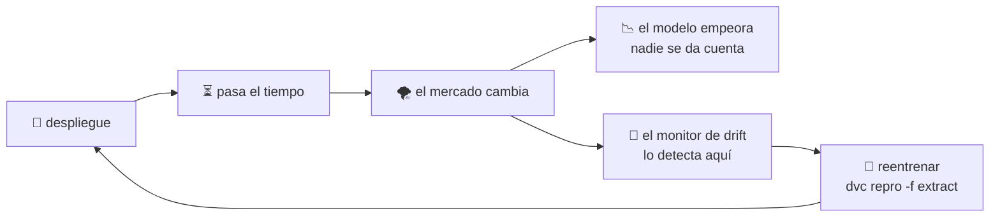
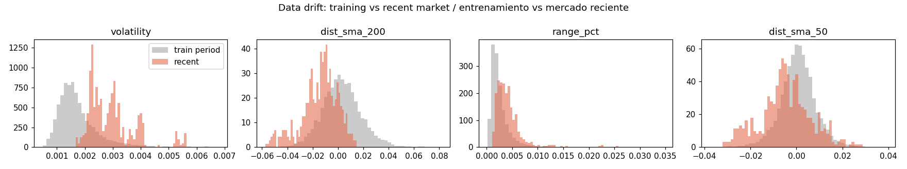
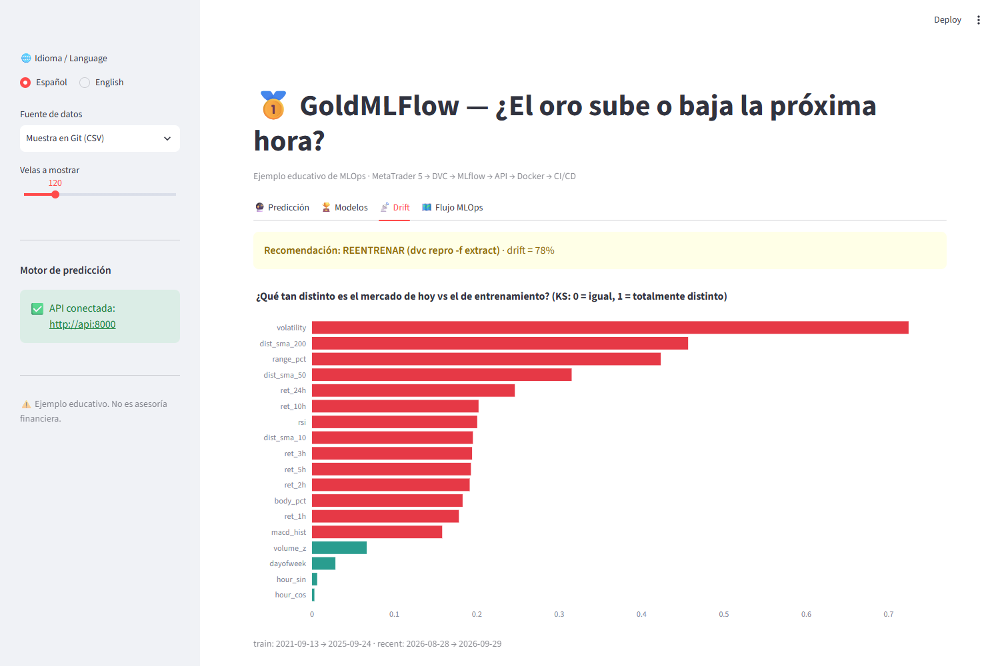

# 10 · Monitoreo y data drift

> 🌐 [English](../en/10-monitoring.md) · **Español** · ⬅️ [09 · CI/CD](09-ci-cd.md) · ➡️ [11 · Dashboard](11-dashboard.md)

| | |
|---|---|
| 🍳 **Analogía** | 📋 Revisar si los clientes siguen pidiendo los mismos platos que cuando diseñaste el menú |
| 🎯 **Objetivo** | Detectar cuándo el mercado de hoy ya no se parece al que usó el modelo para aprender |
| 📓 **Notebook** | [`07_monitor_drift`](../../notebooks/07_monitor_drift.ipynb) |
| 🏭 **Código de producción** | [`src/monitoring/drift.py`](../../src/monitoring/drift.py) (última etapa de DVC) |

## 📉 Por qué los modelos empeoran en silencio



Un modelo aprende patrones de un **periodo**. Si el mercado cambia (nuevo régimen de volatilidad, crisis, rally), esos patrones pueden dejar de funcionar. Eso es **data drift**.

## 📏 Cómo lo medimos: la prueba KS

Para cada pista comparamos dos histogramas, **periodo de entrenamiento** vs **últimas 500 horas**, con la prueba de **Kolmogorov–Smirnov**: un número de **0 (idénticos) a 1 (totalmente distintos)**.



## 🔎 Lo que encontramos (datos reales)

| Pista | KS | Significado |
|---|---|---|
| `volatility` | **0,72** | el oro está **mucho** más volátil ahora que en la mayor parte de 2021–2025 |
| `dist_sma_200` | 0,46 | el precio está lejos de su promedio de largo plazo (gran rally/corrección) |
| `range_pct` | 0,42 | las velas son más grandes |
| `hour_sin`, `hour_cos`, `dayofweek` | ~0,00–0,03 | las pistas de calendario no derivan (¡obvio!) |

➡️ **El 78 % de las pistas derivó → `retrain_recommended: true`** en `reports/drift.json`.



## 🔁 Qué hacer cuando salta la alarma

```powershell
dvc repro -f extract     # descarga velas nuevas → se re-ejecuta TODO el pipeline
dvc push                 # guarda la nueva versión de datos
git add dvc.lock models/champion reports && git commit -m "retrain: datos nuevos"
git push                 # el CI lo revisa y el CD lo publica
```

Un nuevo campeón solo se promueve si **pasa el control de calidad**; si no, se queda el anterior.

## 💡 Siguiente nivel

- Ejecutar la revisión de drift **de forma programada** (GitHub Actions `schedule:` o el Programador de tareas de Windows) y enviar una alerta (email/Slack/Telegram).
- Monitorear también el **desempeño**: guardar cada predicción en vivo y compararla con lo que realmente pasó (el "acierto en la ventana" del dashboard lo muestra de forma visual).
- Herramientas: Evidently, WhyLabs, Arize, Prometheus + Grafana.

---
⬅️ [09 · CI/CD](09-ci-cd.md) · ➡️ [11 · Dashboard en Streamlit](11-dashboard.md)
