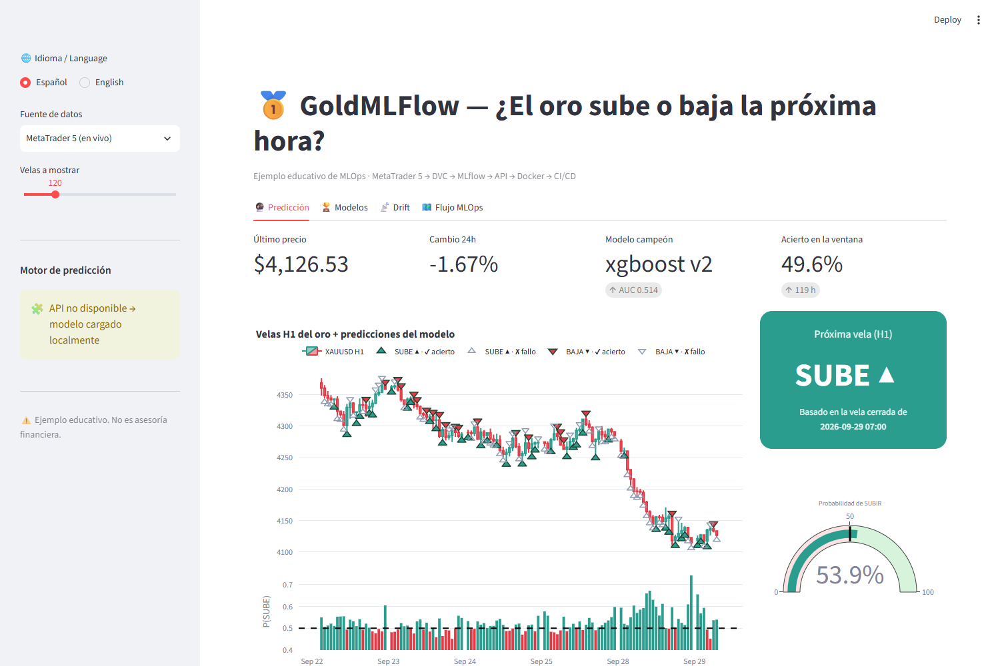
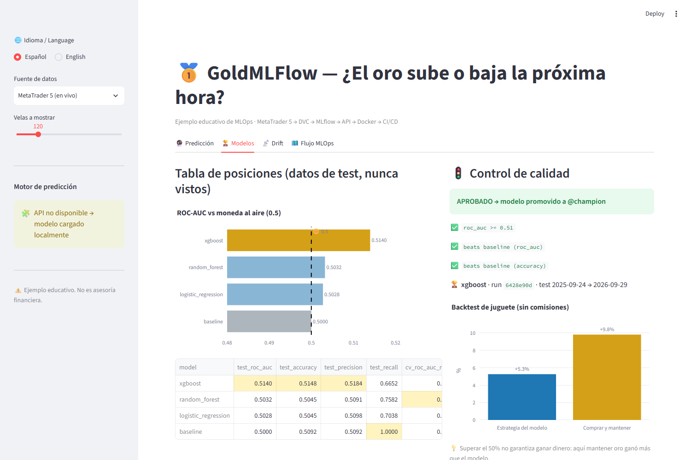
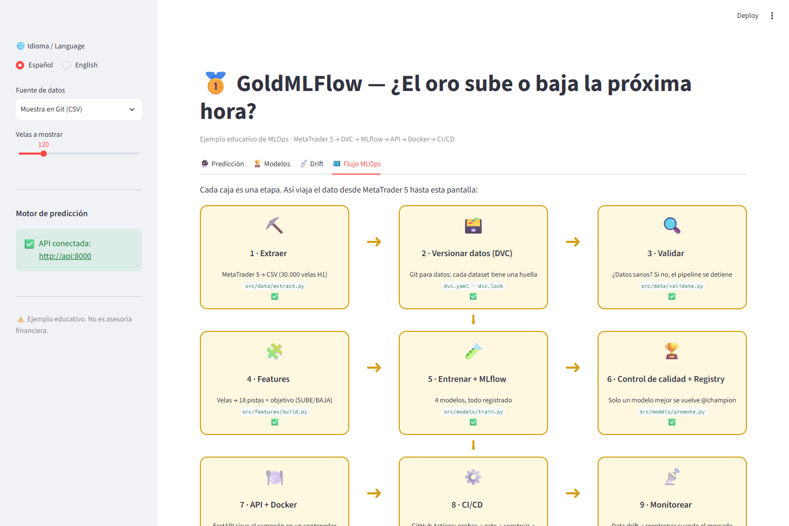
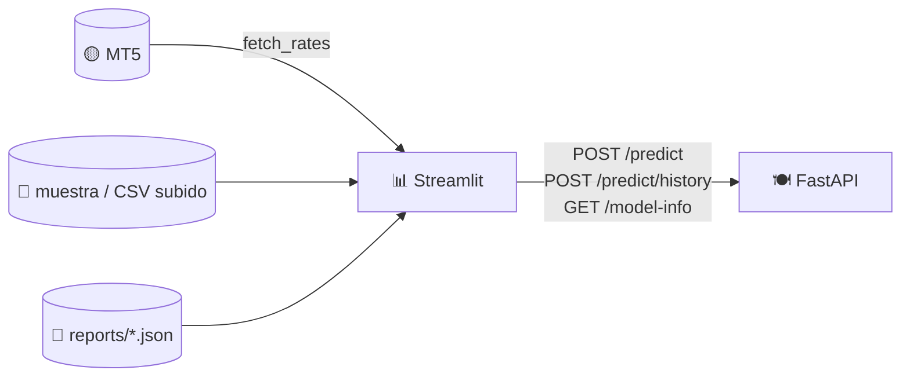

# 11 · Dashboard en Streamlit: ver y usar el modelo

> 🌐 [English](../en/11-dashboard.md) · **Español** · ⬅️ [10 · Monitoreo](10-monitoring.md) · ➡️ [12 · Notebook → producción](12-notebook-to-production.md)

| | |
|---|---|
| 🍳 **Analogía** | 🪑 El comedor: donde los clientes (personas no técnicas) ven y disfrutan la comida |
| 🎯 **Objetivo** | Mostrar todo el proyecto de forma visual a cualquier persona, en español o inglés |
| 🏭 **Código** | [`app/dashboard.py`](../../app/dashboard.py) |
| ▶️ **Ejecutar** | `streamlit run app/dashboard.py` → http://localhost:8501 · o `docker compose up` |

## 🧭 Barra lateral

| Control | Opciones |
|---|---|
| 🌐 Idioma | Español / English |
| Fuente de datos | **MetaTrader 5 (en vivo)** (solo Windows) · CSV de muestra en Git · subir tu propio CSV |
| Velas a mostrar | 48 – 400 |
| Motor de predicción | ✅ API conectada → usa la API · si no, carga la misma app FastAPI dentro del proceso |

## 🔮 Pestaña 1: Predicción

- **Tarjetas**: último precio, cambio en 24 h, modelo campeón + AUC y **acierto** del modelo en las velas visibles.
- **Tarjeta grande + indicador**: la predicción para la **próxima hora** (SUBE ▲ / BAJA ▼) y su probabilidad.
- **Gráfico de velas**: cada triángulo es lo que dijo el modelo *antes* de esa hora (▲ SUBE bajo la vela, ▼ BAJA encima). **Con color = acertó ✔, vacío gris = falló ✘**.
- **Barras de abajo**: P(SUBE) por hora; por encima de la línea punteada del 50 % → dijo SUBE.

## 🏆 Pestaña 2: Modelos

Tabla de posiciones contra la 🪙 moneda al aire, tabla de métricas, resultado del 🚦 control de calidad y backtest de juguete (modelo vs comprar y mantener).

## 📡 Pestaña 3: Drift

Qué pistas cambiaron más entre el periodo de entrenamiento y hoy, más la recomendación de reentrenar (ver [capítulo 10](10-monitoring.md)).

## 🗺️ Pestaña 4: Flujo MLOps

Las 9 etapas como cajas: ✅ cuando existe la salida de esa etapa. Perfecta para **explicarle el proyecto a alguien que no sabe nada de MLOps**, caja por caja.

## 🧱 Cómo está construido

- El dashboard es un **cliente** de la API (separación de responsabilidades: interfaz ≠ modelo).
- Si la API no está corriendo, levanta la **misma** app FastAPI dentro del proceso (`TestClient`), así nunca duplica lógica.
- Revisa `/model-info`, no solo `/health`, para asegurarse de que lo que hay en ese puerto es *nuestra* API.

---
⬅️ [10 · Monitoreo](10-monitoring.md) · ➡️ [12 · Del notebook a producción](12-notebook-to-production.md)
