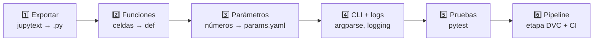

# 12 · Del notebook al código de producción

> 🌐 [English](../en/12-notebook-to-production.md) · **Español** · ⬅️ [11 · Dashboard](11-dashboard.md) · ➡️ [13 · Glosario y FAQ](13-glossary-faq.md)

| | |
|---|---|
| 🍳 **Analogía** | 🧪 El chef experimenta libremente en la cocina de pruebas (notebook); la receta ganadora se escribe en una ficha precisa que cualquier cocinero puede repetir (`.py`) |
| 🎯 **Objetivo** | Entender **por qué y cómo** cada notebook se convirtió en un script de producción |

## 🔀 Dos mundos, dos trabajos

| 📓 Notebook | 🏭 Script `.py` |
|---|---|
| **Descubrir**: probar, graficar, equivocarse | **Repetir**: el mismo resultado siempre |
| Las celdas corren en cualquier orden (¡estado oculto!) | Corre de arriba a abajo, siempre |
| Valores escritos a mano | Valores desde `params.yaml` |
| Tú miras el resultado | Logs, códigos de salida, reportes JSON |
| Difícil de probar / revisar en Git | Pruebas unitarias, code review, CI |
| Se ejecuta haciendo clic en ▶ | Lo ejecutan DVC, el CI y Docker |

## 🗺️ El mapa de este proyecto

| Notebook | Se convirtió en | Prueba |
|---|---|---|
| [`01_extract_mt5`](../../notebooks/01_extract_mt5.ipynb) | [`src/data/extract.py`](../../src/data/extract.py) | — (necesita MT5) |
| [`02_validate_explore`](../../notebooks/02_validate_explore.ipynb) | [`src/data/validate.py`](../../src/data/validate.py) | `tests/test_data.py` |
| [`03_features`](../../notebooks/03_features.ipynb) | [`src/features/build.py`](../../src/features/build.py) | `tests/test_features.py` |
| [`04_train_mlflow`](../../notebooks/04_train_mlflow.ipynb) | [`src/models/train.py`](../../src/models/train.py) | pipeline de humo del CI |
| [`05_evaluate_registry`](../../notebooks/05_evaluate_registry.ipynb) | [`src/models/promote.py`](../../src/models/promote.py) + `check_gate.py` | control de calidad del CI |
| [`06_serve_api`](../../notebooks/06_serve_api.ipynb) | [`src/api/main.py`](../../src/api/main.py) + `Dockerfile` | `tests/test_api.py` |
| [`07_monitor_drift`](../../notebooks/07_monitor_drift.ipynb) | [`src/monitoring/drift.py`](../../src/monitoring/drift.py) | pipeline de humo del CI |

Cada notebook termina con una tabla **"🔁 Del notebook a producción"** que muestra exactamente qué cambió.

## 🪜 Los 6 pasos (hazlos en este orden)



### 1️⃣ Exportar el notebook a un `.py` plano

```powershell
jupytext --to py:percent notebooks/03_features.ipynb -o notebooks/exported/03_features.py
```

Los resultados están en [`notebooks/exported/`](../../notebooks/exported/): el notebook como texto, con `# %%` marcando cada celda. **Es un punto de partida, no código de producción.**

### 2️⃣ Convertir celdas en funciones

```python
# 📓 celda del notebook
X["rsi"] = 100 - 100 / (1 + gain / loss)
```
```python
# 🏭 src/features/build.py
def rsi(close: pd.Series, window: int) -> pd.Series:
    """Relative Strength Index (0-100)."""
    ...
```

### 3️⃣ Mover los números mágicos a `params.yaml`

```python
for w in [10, 50, 200]:                  # 📓 escrito a mano
for w in p["sma_windows"]:               # 🏭 desde params.yaml → DVC re-ejecuta cuando cambia
```

### 4️⃣ Agregar línea de comandos y logs

```python
parser.add_argument("--input", default=params["features"]["processed_path"])
log.info("%d rows x %d features | saved %s", ...)
```
→ el mismo script sirve para los datos completos (DVC) y para la muestra (CI).

### 5️⃣ Escribir pruebas para lo que revisaste "a ojo"

En el notebook 03 *vimos* la fuga de datos en un gráfico → en producción `test_no_leakage_features_ignore_the_future` lo verifica en cada push.

### 6️⃣ Conectarlo al pipeline

Agrega una etapa en `dvc.yaml` (deps, params, outs) y, si hace falta, un paso en `ci.yml`.

## ✅ Checklist: ¿mi script está listo para producción?

- [ ] Sin estado oculto: corre de arriba a abajo en una terminal limpia
- [ ] Sin rutas ni números escritos a mano → `params.yaml`
- [ ] `if __name__ == "__main__": main()`
- [ ] Errores claros y código de salida distinto de 0 si falla
- [ ] Al menos una prueba para su lógica crítica
- [ ] Declarado como etapa de DVC con deps/outs
- [ ] Pasa `ruff check`

---
⬅️ [11 · Dashboard](11-dashboard.md) · ➡️ [13 · Glosario y FAQ](13-glossary-faq.md)
